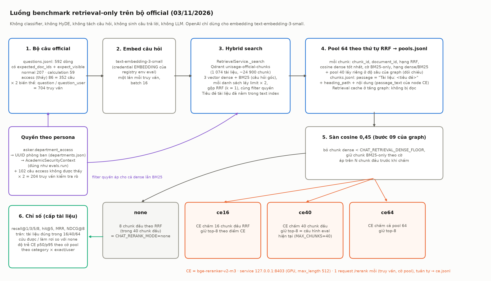
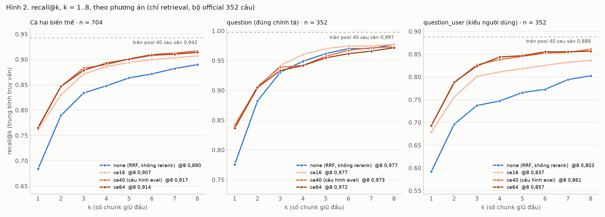
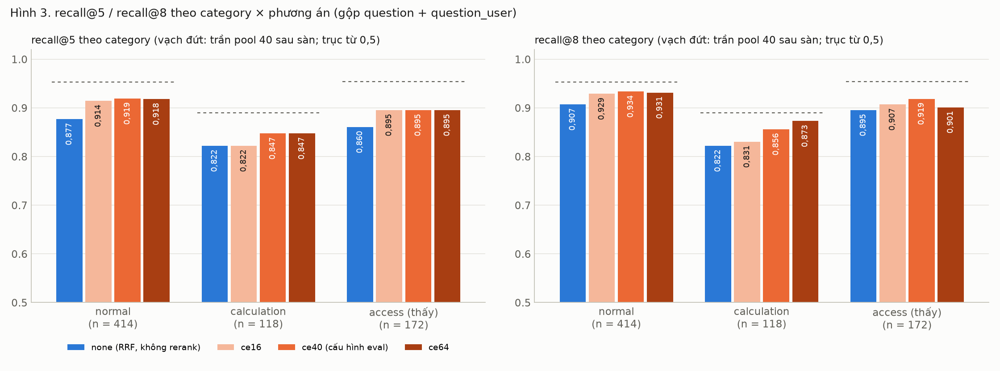
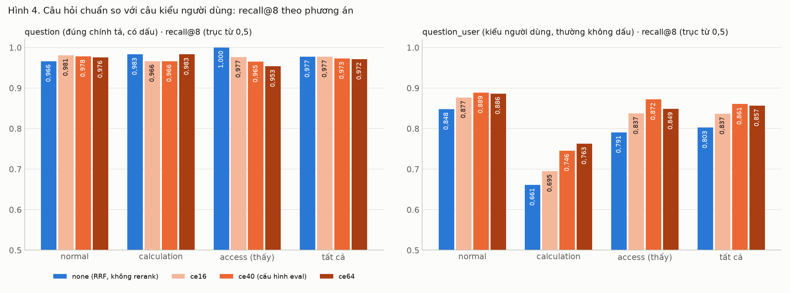
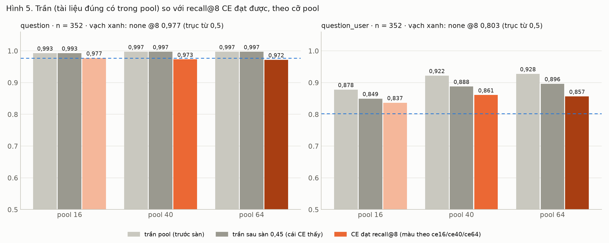
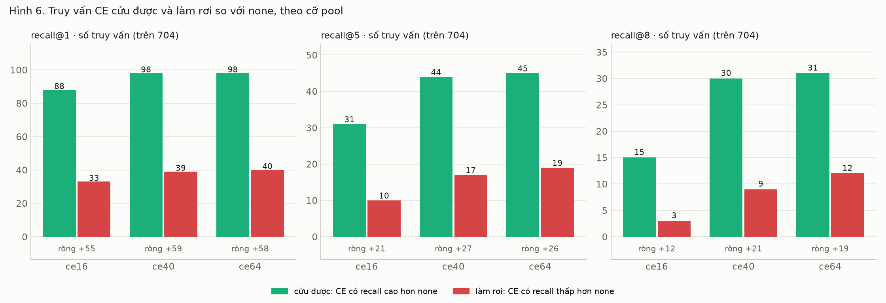
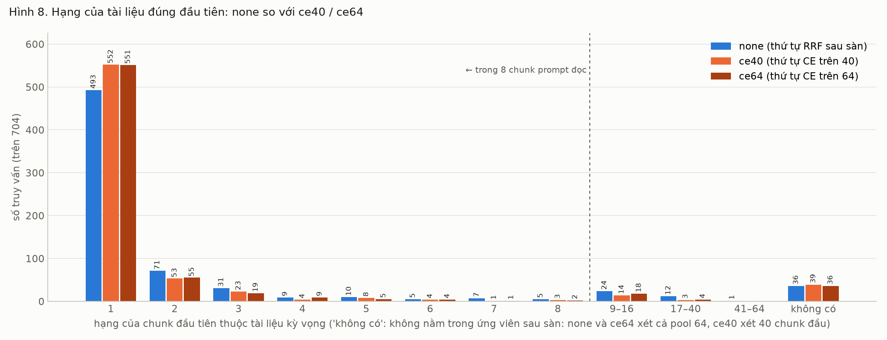
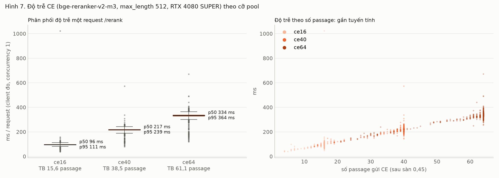

# Benchmark cross-encoder trên bộ official: chỉ retrieval (UNISAGE-106, bước 1)

Ngày đo 03/11/2026 · RTX 4080 SUPER 16 GB · Qdrant `unisage-official-chunks` (env eval, 1 074 tài
liệu, ~24 900 chunk) · chạy lại: `plan.md` mục Lệnh · từng câu, phân tích lỗi: `report-full.md` ·
số liệu thô: `benchmark_results/03-11-2026-ce-official/` (gitignore) · bảng tính: `report.xlsx`.

Tiền thân: `changes/22-10-2026-CrossEncoderBenchmark/` (26/10, bộ demo 139 câu). Ở đó thứ tự RRF đã
chạm trần (0,928) nên không đo được giá trị của CE. Bộ official to hơn 10 lần và có nhiều thông báo,
quyết định gần trùng theo năm, nên đo lại ở đây. Lần này **chỉ đo retrieval**: không sinh câu trả
lời, không judge, không gọi LLM nào (OpenAI chỉ dùng cho embedding).

Bốn phương án, cùng một pool 64 ứng viên cho mỗi truy vấn, giữ K = 8 chunk (số chunk prompt sinh đọc):

| Phương án | Làm gì | Ứng với cấu hình |
|---|---|---|
| `none` | sàn cosine 0,45, lấy 8 chunk đầu theo thứ tự RRF trong 40 chunk đầu | `CHAT_RERANK_MODE=none` |
| `ce16` | sàn trên 16 chunk đầu RRF, CE chấm, giữ top-8 theo điểm CE | `cross_encoder`, `CHAT_RETRIEVAL_MAX_CHUNKS=16` (mặc định code) |
| `ce40` | như trên với 40 chunk đầu | **`.env.eval` hiện tại** (`cross_encoder`, `MAX_CHUNKS=40`) |
| `ce64` | như trên với cả pool 64 | mở rộng thêm |

## 0. Thuật ngữ

| Từ khoá | Nghĩa |
|---|---|
| truy vấn | một câu hỏi ở một biến thể: `question` (đúng chính tả, có dấu) hoặc `question_user` (kiểu người dùng, nhiều câu không dấu, viết tắt) |
| pool N | N chunk đầu theo thứ tự RRF của hybrid search (dense + BM25) với filter quyền của persona |
| sàn | `CHAT_RETRIEVAL_DENSE_FLOOR` 0,45: graph bỏ chunk có cosine dense < 0,45 trước bước rerank; chunk chỉ BM25 tìm thấy được giữ theo cờ |
| recall@k | phần tài liệu kỳ vọng có trong k chunk giữ đầu (cấp tài liệu; 15/454 câu có 2 tài liệu kỳ vọng) |
| hit@5 | 1 nếu ít nhất một tài liệu kỳ vọng nằm trong 5 chunk đầu |
| MRR | trung bình 1/hạng của chunk đúng đầu tiên trong 8 chunk giữ (0 nếu không có) |
| NDCG@8 | NDCG nhị phân cấp tài liệu trên 8 chunk giữ: mỗi tài liệu đúng tính một lần, ở chunk đầu tiên của nó |
| trần pool N | recall@N của chính pool: cao nhất mà một bộ rerank chọn trong N chunk đầu có thể đạt; "sau sàn" = chỉ tính chunk qua sàn (cái CE thực sự thấy) |
| cứu được / làm rơi | số truy vấn mà recall@k của CE cao hơn / thấp hơn `none` |
| p50 / p95 | 50 % / 95 % request nhanh hơn giá trị này (client đo, concurrency 1) |

## 1. Kết luận

### 1.1. Bảng tổng (704 truy vấn = 352 câu × 2 biến thể)

| Chỉ số | `none` | `ce16` | `ce40` | `ce64` |
|---|---|---|---|---|
| recall@1 | 0,684 | 0,761 | **0,766** | 0,765 |
| recall@3 | 0,834 | 0,871 | **0,883** | 0,879 |
| recall@5 | 0,864 | 0,894 | **0,901** | **0,901** |
| recall@8 | 0,890 | 0,907 | **0,917** | 0,914 |
| hit@5 | 0,872 | 0,905 | **0,909** | 0,908 |
| MRR | 0,775 | 0,831 | **0,838** | 0,837 |
| NDCG@8 | 0,799 | 0,845 | **0,854** | 0,852 |
| trần pool (sau sàn) | 0,942 (pool 40) | 0,921 | 0,942 | 0,947 |
| cứu được / làm rơi @8 so với `none` | — | 15 / 3 | 30 / 9 | 31 / 12 |
| cứu được / làm rơi @5 | — | 31 / 10 | 44 / 17 | 45 / 19 |
| độ trễ CE p50 / p95 | 0 | **96 / 111 ms** | 217 / 239 ms | 334 / 364 ms |
| rò quyền (204 truy vấn không được thấy) | 0 | 0 | 0 | 0 |

Theo category (recall@5 / recall@8):

| Category (truy vấn) | `none` | `ce16` | `ce40` | `ce64` |
|---|---|---|---|---|
| normal (414) | 0,877 / 0,907 | 0,914 / 0,929 | **0,919 / 0,934** | 0,918 / 0,931 |
| calculation (118) | 0,822 / 0,822 | 0,822 / 0,831 | **0,847** / 0,856 | **0,847 / 0,873** |
| access thấy được (172) | 0,860 / 0,895 | 0,895 / 0,907 | **0,895 / 0,919** | **0,895** / 0,901 |

Theo biến thể câu hỏi (recall@5 / recall@8):

| Biến thể (truy vấn) | `none` | `ce16` | `ce40` | `ce64` | trần pool 40 sau sàn |
|---|---|---|---|---|---|
| `question` (352) | 0,962 / **0,977** | **0,970 / 0,977** | 0,957 / 0,973 | 0,955 / 0,972 | 0,997 |
| `question_user` (352) | 0,766 / 0,803 | 0,818 / 0,837 | **0,845 / 0,861** | **0,847** / 0,857 | 0,888 |
| ↳ có dấu (275) | 0,865 / 0,904 | 0,918 / 0,936 | **0,938 / 0,955** | **0,938** / 0,949 | — |
| ↳ không dấu (77) | 0,409 / 0,442 | 0,461 / 0,481 | 0,513 / **0,526** | **0,519 / 0,526** | trần pool 64: 0,714 |

### 1.2. Kết luận

1. **Trên bộ official, CE có việc để làm.** Khác bộ demo, thứ tự RRF không còn chạm trần: `none` đạt
   recall@8 0,890 trong khi tài liệu đúng nằm trong 40 chunk đầu (sau sàn) ở 0,942. `ce40` lấy lại hơn
   một nửa khoảng cách đó: recall@8 **+2,7 điểm** (0,890 → 0,917), recall@5 **+3,7**, recall@1 **+8,2**,
   MRR +0,063. Cứu 30 truy vấn, làm rơi 9 (ròng +21).
2. **Lợi ích gần như toàn bộ đến từ câu kiểu người dùng.** Với `question` đúng chính tả, RRF đã gần trần
   (0,977 so với trần 0,997) và CE không thêm gì ở recall@8 (0,973–0,977, cứu 7 rơi 7), chỉ đẩy tài
   liệu đúng lên hạng 1 nhiều hơn (recall@1 0,776 → 0,839). Với `question_user`, CE tăng recall@8
   +5,8 điểm (0,803 → 0,861) và recall@5 +7,9 điểm, làm rơi chỉ 2 truy vấn.
3. **Mở pool từ 16 lên 40 đáng; từ 40 lên 64 không.** `ce16` → `ce40`: +1,0 điểm recall@8, +2,4 điểm
   ở `question_user`, trả thêm ~120 ms. `ce40` → `ce64`: trần chỉ tăng 0,005, recall@8 giảm 0,003
   (làm rơi 12 so với 9), trả thêm ~115 ms. Chỉ calculation hưởng lợi từ 64 (+1,7 điểm, 2 truy vấn).
4. **Chỗ CE làm hỏng là các tài liệu gần trùng.** 9 truy vấn `ce40` làm rơi đều là trường hợp có nhiều
   tài liệu cùng khuôn: các bản đăng ký chức danh phó giáo sư của từng người, đề cương ôn thi thạc sĩ
   môn "Mạch điện tử" và "Lý thuyết mạch điện", portfolio của từng sinh viên ngành May, chương trình
   so với kế hoạch đào tạo thạc sĩ cùng ngành. CE chọn một bản đúng về nội dung nhưng khác bản nhãn kỳ
   vọng; một phần là nhãn hẹp hơn câu hỏi (report-full mục 5.3).
5. **Phần lớn lỗi còn lại không do rerank.** Trong 61 truy vấn `ce40` chưa đạt recall@8 = 1: 25 truy
   vấn tài liệu đúng không có trong pool 64 (24 là câu kiểu người dùng, đa số không dấu), 12 bị **sàn
   0,45** cắt mất trước khi CE thấy, 2 nằm ở hạng 41–64, chỉ 22 là CE xếp sai (report-full mục 5).
6. **Sàn cosine 0,45 đang làm hại khi bật CE.** Đo phụ: cùng `ce40` nhưng bỏ sàn, recall@8 tăng
   0,917 → **0,933** (+11 truy vấn, 0 truy vấn kém đi), `question_user` 0,861 → 0,892. Câu không dấu
   có cosine dense thấp (thường 0,40–0,50) nên sàn cắt đúng các chunk mà CE đọc được.
7. **Câu không dấu là điểm yếu lớn nhất của retrieval**, không phải của rerank: 77 truy vấn, trần pool 64
   chỉ 0,714, recall@8 0,44–0,53 ở mọi phương án. BM25 không gập dấu nên câu không dấu chỉ khớp tài liệu
   OCR mất dấu: "Plan 67-KH-ĐHCN – Anti-terrorism work of IUH in 2025" (văn bản không dấu) lọt top-8
   RRF của 57 truy vấn.
8. **q0054 và d0315** (2 câu trượt retrieval ở smoke test 30 câu): q0054 trong benchmark này **không
   trượt**: tài liệu đúng ở hạng 1 cả hai biến thể, mọi phương án. Lần trượt ở smoke test do phần trước
   retrieval của graph (HyDE / tách câu / câu hỏi độc lập), không do hybrid search hay rerank. d0315
   trượt thật: tài liệu kỳ vọng là sổ tay **tiếng Anh** ("Handbook for Student 2024 – School of
   Finance and Accounting", 69 chunk, public), câu hỏi tiếng Việt; không chunk nào của nó vào pool 64
   (dense hạng > 128). CE không cứu được; cần xử lý ở retrieval (truy vấn song ngữ) hoặc nhãn.
9. **Không rò quyền**: 204 truy vấn của 102 câu access mà persona không được thấy, tài liệu kỳ vọng không
   xuất hiện trong pool 64 ở bất kỳ truy vấn nào.

### 1.3. Khuyến nghị cho bước 2 (eval e2e trên mẫu)

- **Dùng `ce40`**: `CHAT_RERANK_MODE=cross_encoder`, `CHAT_RETRIEVAL_MAX_CHUNKS=40`,
  `CHAT_CROSS_ENCODER_KEEP=8` (đúng `.env.eval` hiện tại). Tốt nhất hoặc ngang tốt nhất ở mọi chỉ số
  tổng, 217 ms p50 mỗi câu hỏi con. `ce64` không thêm gì mà chậm hơn 50 %; `ce16` chỉ nên dùng nếu
  GPU yếu (3060) làm 40 passage quá chậm.
- **Thêm một nhánh `ce40` + sàn 0** (`CHAT_RETRIEVAL_DENSE_FLOOR=0` khi chạy eval) vào bước 2: +1,6
  điểm recall@8 ở retrieval, nhưng sàn còn là tín hiệu "không có ngữ cảnh" cho web search / ticket và
  cho câu unanswerable, nên phải đo e2e (từ chối, bịa trên 20 câu unanswerable) trước khi đổi.
- **Giữ `none` làm mốc** ở bước 2 để đo xem +2,7 điểm recall@8 có đổi thành câu trả lời tốt hơn không
  (ở bộ demo, MRR cao hơn không đổi thành câu trả lời tốt hơn vì prompt đọc cả 8 chunk).
- Ticket riêng, không thuộc rerank: (a) câu không dấu: gập dấu cho BM25 (index + truy vấn) hoặc khôi
  phục dấu trước khi tìm; (b) truy vấn song ngữ cho tài liệu tiếng Anh (d0315); (c) xem lại nhãn của
  các nhóm tài liệu gần trùng (report-full mục 5.3).

### 1.4. Giới hạn

- **Không qua classifier, HyDE, tách câu hỏi**: câu hỏi đi thẳng vào search (dense lẫn BM25). Trong graph,
  dense embed văn bản HyDE và BM25 dùng câu hỏi độc lập do LLM viết lại (thường có dấu), nên khoảng cách
  ở câu kiểu người dùng (và lợi ích của CE trên chúng) có thể nhỏ hơn ở e2e. Bước 2 sẽ đo.
- **Một câu hỏi con mỗi truy vấn**: không có quota chia pool giữa các câu hỏi con như graph làm khi
  tách câu.
- **Thứ tự pool**: mọi phương án đọc tiền tố của pool 64. Lấy riêng ở độ sâu 40 (như graph) cho cùng tập
  chunk ở 98,5 % và **cùng recall@8 cấp tài liệu (0,901)** cho 8 chunk đầu chưa sàn, nhưng thứ tự 40 chunk
  chỉ trùng hoàn toàn ở 74/704 truy vấn (độ sâu fetch đổi điểm RRF); 8 chunk đầu trùng hoàn toàn 599/704.
- Recall cấp tài liệu: không kiểm tra chunk giữ có chứa đúng đoạn trả lời (evidence) hay không.
- Nhãn `expected_doc_ids` do model sinh, `reviewed=false`: một phần "làm rơi" là nhãn hẹp.
- Độ trễ đo với service đang phục vụ hệ thống live (dùng chung GPU), tuần tự; request đầu tiên 1 022 ms
  (khởi động), các request sau ổn định.

## 2. Cách đo

*Hình 1. Luồng benchmark: bộ câu → embed → hybrid dense + BM25 → RRF pool 64 → sàn → none / ce16 /
ce40 / ce64 → chỉ số.*

- **Bộ câu**: `unisage-gateway/dataset/official/questions.jsonl` (592 dòng). Lấy dòng có
  `expected_doc_ids` và `expect_visible` true: normal 207, calculation 59, access 86 = 352 câu, mỗi câu
  2 biến thể = 704 truy vấn. Thêm 102 câu access `expect_visible` false × 2 = 204 truy vấn chỉ để kiểm
  tra rò quyền. `expected_doc_ids` (file_id của manifest) đổi sang `document_id` của Qdrant bằng chính
  `evals.run.runner.document_ids`; quyền: `access_of` + `security_of` (persona → UUID phòng ban) như
  `evals.run`.
- **Retrieval** (`evals/benchmark/retrieval_pool.py collect`): embed câu hỏi một lần
  (`text-embedding-3-small`, credential EMBEDDING của registry env eval), gọi
  `RetrievalService._search` (3 vector dense + BM25 của chính câu hỏi, mỗi danh sách lấy limit × 2,
  RRF k = 1, filter quyền) ở độ sâu 64, và một lần nữa ở độ sâu 40 để đối chiếu. Đây là tầng dưới
  retrieval cache (cache nằm ở graph) nên không đọc entry cũ. Tiêu đề tài liệu đã nằm trong văn bản
  được index (dense lẫn BM25). Ghi `pools.jsonl` + `chunks.jsonl` (passage = `passage_text` của node CE).
- **CE** (`... ce`): service đang chạy ở 127.0.0.1:8403 (bge-reranker-v2-m3, FP16, `max_length` 512,
  không spawn, không tắt). Mỗi truy vấn × mỗi cỡ 16/40/64: sàn trên N chunk đầu, một request `/rerank`,
  tuần tự, timeout client 30 s; xếp theo điểm, hoà giữ thứ tự RRF (như `cross_encoder_rerank`). 0 lỗi.
- **Chỉ số** (`... score` + `assets/analyze.py`): tính offline từ các file trên; phụ: `ce40` không sàn
  (`benchmark_results/03-11-2026-ce-official/nofloor/`).
- K = 8: `CHAT_CROSS_ENCODER_KEEP` = `CHAT_CONTEXT_MAX_CHUNKS` = 8 (mặc định code, `.env.eval` không đặt).
  Không LLM nào được gọi; chi phí chỉ là ~908 embedding.

## 3. Accuracy

*Hình 2. recall@k, k = 1..8. Trái: cả hai biến thể; giữa: `question`, các đường CE và `none` gặp nhau
từ k = 3; phải: `question_user`, CE cao hơn `none` 5–10 điểm ở mọi k.*

*Hình 3. recall@5 và recall@8 theo category. CE tăng ở cả ba; calculation thấp nhất và còn xa trần.*

*Hình 4. Với câu đúng chính tả, bốn phương án ngang nhau (access: CE làm rơi 3 câu tài liệu gần trùng);
với câu kiểu người dùng, CE hơn rõ ở mọi category.*

Đọc số:

- Với `question`, RRF hầu như đã đúng: tài liệu kỳ vọng ở hạng 1 trong 77,6 % truy vấn, trong 8 chunk đầu
  ở 97,7 %. CE chỉ đổi thứ tự trong 8 chunk đó (recall@1 +6,3 điểm) và đôi khi đổi bản gần trùng.
- Với `question_user`, dense yếu (cosine thấp, nhiều câu không dấu) và BM25 kéo vào tài liệu khớp từ
  không dấu; CE đọc cả câu hỏi lẫn passage nên loại được phần lớn nhiễu đó.
- calculation `question_user` thấp nhất (recall@8 0,661 ở `none`, 0,746 ở `ce40`, 0,763 ở `ce64`): câu
  tính toán kiểu người dùng thường bỏ tên văn bản ("qua trinh 9 (20%), giua ky 7…"), tài liệu kỳ vọng
  không nằm trong pool.

## 4. Trần, cứu được, làm rơi

*Hình 5. Trần pool (trước và sau sàn) so với recall@8 CE đạt. `question`: trần ~1,0 ở mọi cỡ.
`question_user`: trần tăng 16 → 40 (0,849 → 0,888 sau sàn) rồi gần như đứng ở 64 (0,896); sàn lấy đi
3,4 điểm trần ở pool 40.*

*Hình 6. Số truy vấn CE cứu được / làm rơi so với `none`. Ở recall@8, `ce40` ròng +21, `ce64` +19,
`ce16` +12; ở recall@1 cả ba ròng +55–59.*

*Hình 8. Hạng của chunk đúng đầu tiên. CE đưa 59 truy vấn lên hạng 1 (493 → 552) và kéo phần lớn
truy vấn hạng 9–40 của `none` vào top-8 (36 → 17).*

| Trần (recall trong pool) | pool 8 | pool 16 | pool 40 | pool 64 |
|---|---|---|---|---|
| trước sàn, cả hai biến thể | 0,901 | 0,935 | 0,960 | 0,962 |
| sau sàn, cả hai biến thể | 0,888 | 0,921 | 0,942 | 0,947 |
| sau sàn, `question` | 0,977 | 0,993 | 0,997 | 0,997 |
| sau sàn, `question_user` | 0,800 | 0,849 | 0,888 | 0,896 |

## 5. Độ trễ CE

*Hình 7. Độ trễ tỉ lệ gần tuyến tính với số passage (~5,3 ms/passage ở `max_length` 512).*

| Cỡ pool | Passage gửi (TB sau sàn) | p50 | p95 | p99 | Max | Service tự đo p50 / p95 | Passage bị cắt ở 512 token |
|---|---|---|---|---|---|---|---|
| 16 | 15,6 | **96 ms** | **111 ms** | 126 ms | 1 022 ms (request đầu) | 78 / 90 ms | 36 % |
| 40 | 38,5 | 217 ms | 239 ms | 261 ms | 572 ms | 199 / 220 ms | 40 % |
| 64 | 61,1 | 334 ms | 364 ms | 397 ms | 671 ms | 315 / 339 ms | 42 % |

Mỗi câu hỏi con một request; câu tách 2–3 câu hỏi con gửi song song nên xếp hàng trên GPU (bộ demo
26/10: service bão hoà compute, req/s phẳng theo mức đồng thời). Ở `ce40`, 3 câu hỏi con ≈ 0,65 s.

## 6. Ca riêng: q0054, d0315

| Truy vấn | Tài liệu kỳ vọng | Hạng RRF | `none` | `ce40` | Ghi chú |
|---|---|---|---|---|---|
| `q0054:exact` | Kế hoạch đào tạo chuyên ngành Điện tử công nghiệp năm 2022 | 1 | hạng 1 | hạng 1 | không trượt ở retrieval-only |
| `q0054:user` | như trên | 1 | hạng 1 | hạng 1 | không trượt |
| `d0315:exact` | Handbook for Student 2024 – School of Finance and Accounting (tiếng Anh) | không có trong 64 | trượt | trượt | tài liệu tiếng Anh, câu hỏi tiếng Việt |
| `d0315:user` | như trên | không có trong 64 | trượt | trượt | như trên |

## 7. Việc còn lại

- Bước 2: eval e2e trên mẫu với `ce40` (và nhánh sàn 0), mốc `none`; đo thêm 20 câu unanswerable.
- Gập dấu cho BM25 / khôi phục dấu truy vấn (77 truy vấn không dấu, trần 0,714).
- Truy vấn song ngữ cho tài liệu tiếng Anh (d0315 và các programme specification).
- Rà nhãn các nhóm tài liệu gần trùng (mục 5.3 của report-full).
- Đo `ce40` trên 3060 (ước p50 ~0,4–0,5 s mỗi câu hỏi con) trước khi chọn cỡ pool cho Windows.

## 8. Phụ lục: lệnh, file

| Bước | Lệnh / file |
|---|---|
| Lấy pool | `task benchmark:pool env=eval -- collect --out benchmark_results/03-11-2026-ce-official` |
| Chấm CE | `task benchmark:pool env=eval -- ce --out benchmark_results/03-11-2026-ce-official` |
| Chỉ số | `task benchmark:pool env=eval -- score --out ...` rồi `python assets/analyze.py <out>` |
| Hình | `python assets/plot_all.py <out> assets` · `python assets/plot_pipeline.py assets/fig1-pipeline.png` (matplotlib, `uv run --isolated --no-project --with matplotlib`) |
| Excel | `uv run --isolated --no-project --with openpyxl --with pillow python assets/build_xlsx.py <out>` |
| Code | `evals/benchmark/retrieval_pool.py`, test `tests/evals/test_benchmark_retrieval_pool.py`, task `benchmark:pool` |
| Dữ liệu | `benchmark_results/03-11-2026-ce-official/`: `pools.jsonl` (908 dòng), `chunks.jsonl` (passage), `ce.jsonl` (704), `per_query.jsonl`, `summary.json`, `nofloor/` (ce40 không sàn); bản sao `summary.json` ở `results/` cạnh báo cáo này |
