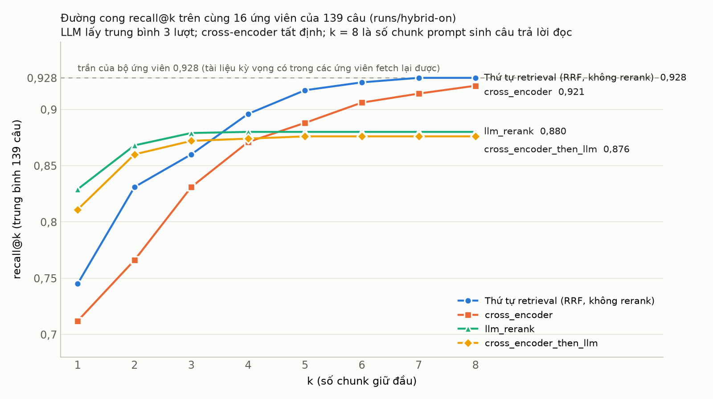
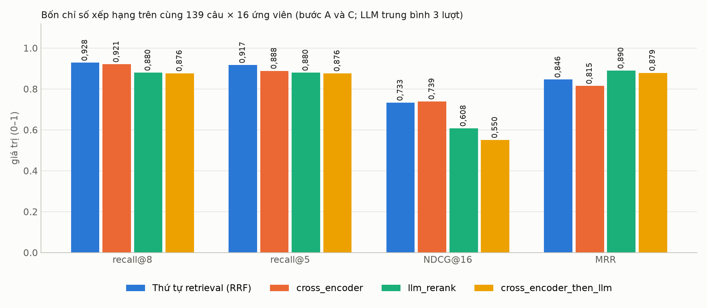
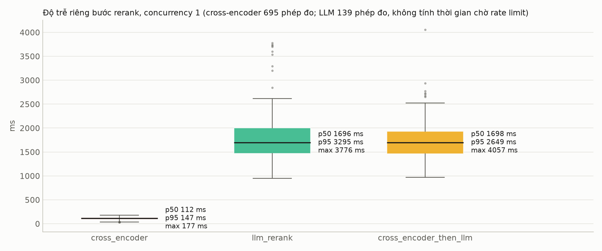
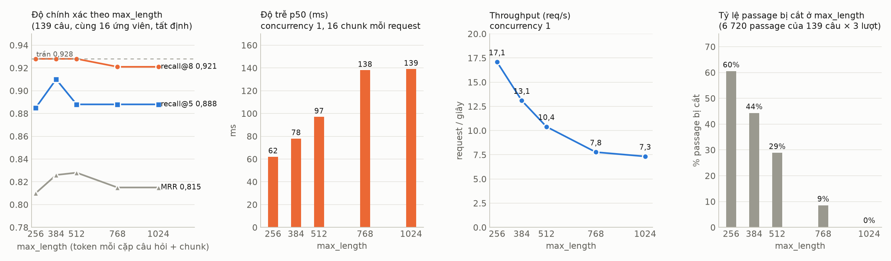
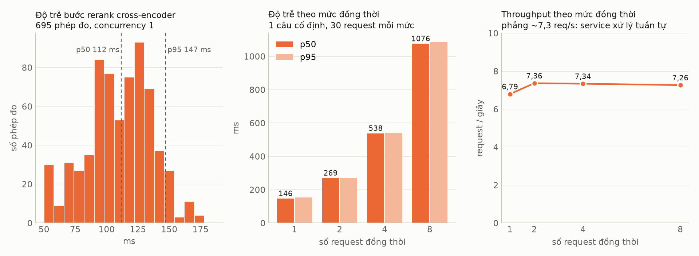
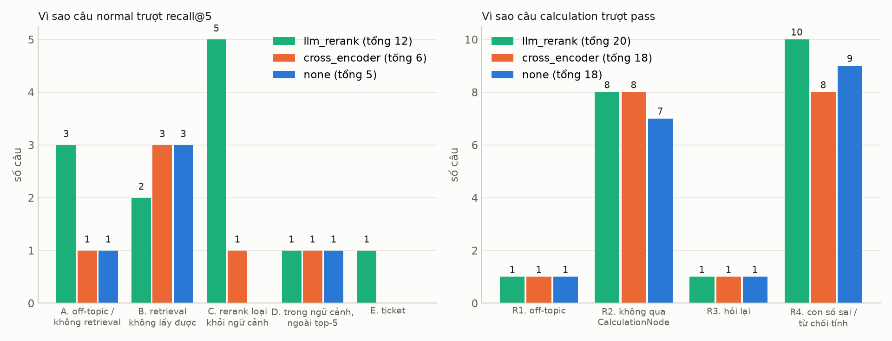

# Benchmark rerank: so sánh 4 phương án (UNISAGE-106)

Ngày đo 26/10/2026 · RTX 4080 SUPER 16 GB · nhánh `feature/huydh-unisage-106-benchmark-cross-encoder`
· chạy lại: `docs/guide/benchmark-rerank.md` · phân tích từng câu, hình phụ, sự cố: `report-full.md`.

Bốn phương án cho bước 09a (rerank) của graph, đặt bằng `CHAT_RERANK_MODE`:

| Phương án | Bước 09a làm gì | Gọi gì |
|---|---|---|
| `none` | sàn cosine 0,45, lấy 8 chunk đầu theo thứ tự retrieval (RRF của hybrid) | không gì |
| `cross_encoder` (CE) | service bge-reranker-v2-m3 chấm 16 cặp (câu hỏi, chunk), giữ top-8 | 1 HTTP local, GPU |
| `llm` (hiện tại) | model RERANK (gpt-5-mini) chọn chunk "trả lời được câu hỏi" | 1 lượt LLM |
| `cross_encoder_then_llm` | CE cắt 16 → 8, LLM chọn trên 8 | HTTP + LLM |

## 0. Thuật ngữ

| Từ khoá | Nghĩa |
|---|---|
| ứng viên | 16 chunk retrieval trả về cho một câu, đầu vào chung của mọi phương án |
| recall@k | phần tài liệu kỳ vọng có trong k chunk giữ đầu; k = 8 là số chunk prompt sinh câu trả lời đọc |
| MRR | trung bình 1/hạng của chunk đúng đầu tiên: đo tài liệu đúng nằm cao đến đâu |
| NDCG@16 | đo cả thứ tự lẫn số chunk đúng giữ được; phạt phương án giữ ít |
| trần | recall cao nhất có thể khi chỉ chọn trong ứng viên (tài liệu kỳ vọng có trong ứng viên): 0,928 |
| Loại hết / Giữ TB | tỷ lệ lượt không giữ chunk nào / số chunk giữ trung bình |
| Tái lập | tỷ lệ câu cho cùng tập chunk ở mọi lần lặp (CE 2 lượt, LLM 3 lượt) |
| p50 / p95 | 50 % / 95 % phép đo nhanh hơn giá trị này |
| req/s | request hoàn thành mỗi giây (throughput) |
| recall@5 e2e | tài liệu kỳ vọng trong 5 chunk đầu của ngữ cảnh; nhánh calculation tính trên trích dẫn |
| pass (calculation) | câu đi qua CalculationNode và con số khớp đáp án |
| refusal | câu trả lời chứa dấu hiệu "chưa có thông tin" |
| fail-open | LLM rerank lỗi thì giữ xếp theo điểm và đi tiếp |

## 1. Kết luận

### 1.1. Bảng tổng 4 phương án

| Trục | `none` | CE | `llm` | CE → LLM |
|---|---|---|---|---|
| -a recall@8 (139 câu, cùng ứng viên; trần 0,928) | **0,928** | 0,921 | 0,880 | 0,876 |
| -a MRR | 0,846 | 0,815 | **0,890** | 0,879 |
| -a tái lập | **100 %** | **100 %** | 49,6 % | 49,6 % |
| -p độ trễ bước rerank p50 / p95 | **0 ms** | 0,11 s / 0,15 s (1024) · 0,09 s / 0,10 s (512) | 1,7 s / 3,3 s | 1,7 s / 2,6 s |
| -c chịu tải | — | 7,3 req/s (1024) · **12 req/s** (512), tuyến tính theo mức đồng thời | giới hạn credential 15 lượt/phút | như `llm` |
| e2e normal recall@5 (116 câu) | **111** | 110 | 104 | 108 |
| e2e calculation pass (38 câu) | 19 (*) | 20 | 18 | **21** |
| e2e từ chối trả lời (154 câu) | 31 | 32 | 41 | **29** |
| e2e cả lượt p50 / p95 | 4,9 s / 8,2 s (*) | **4,6 s / 7,5 s** | 5,3 s / 9,5 s | 6,6 s / 17,9 s |
| USD API / lượt chat (chưa gồm GPU của CE) | **0,00483** | 0,00503 | 0,00557 | 0,00540 |
| 20 câu unanswerable (5 nhóm), Phase 6 | **20/20, 0 bịa** | **20/20, 0 bịa** | 19/20, 1 bịa | — (`auto`: 18/20, 1 bịa, 1 lỗi credential) |
| Cảnh báo grounding trên 20 câu đó | 0 | 0 | 0 | — |
| Cần gì thêm | **không** | GPU ~2,5 GB + service | API + rate limit | cả hai |

(*) `none` có 1 lượt lỗi 504 của model sinh (33 s), không liên quan rerank.

### 1.2. Kết luận

1. **Bước rerank không còn việc để làm trên corpus này.** Thứ tự RRF của hybrid retrieval (`none`)
   đạt trần 0,928: tài liệu kỳ vọng đã nằm trong top-8 ở mọi câu mà retrieval lấy được. Mọi bộ
   rerank chỉ có thể giữ nguyên hoặc làm hỏng.
2. **LLM rerank làm hỏng.** Nó là bộ lọc (giữ median 2 chunk) và loại nhầm tài liệu đúng ở 12/139
   câu; ở tầng câu trả lời thua `none`/CE 6–7 câu normal, thêm 9–10 câu từ chối, chậm 0,5–0,7 s,
   đắt hơn 10–13 %, và chỉ 49,6 % câu tái lập. Lợi thế duy nhất là MRR (xếp hạng 1 tốt khi
   không loại nhầm), không đổi thành câu trả lời tốt hơn vì prompt đọc cả 8 chunk.
3. **CE bằng `none`** ở mọi trục trong mức nhiễu (±1–2 câu), trả thêm GPU và một service.
4. **CE → LLM** không hơn LLM thuần, chậm nhất, không đáng một tầng.

### 1.3. Khuyến nghị

- **Đặt `CHAT_RERANK_MODE=none` mặc định.** Rẻ nhất, không cần gì thêm, bằng CE về chất lượng.
- **Giữ CE như lựa chọn** cho corpus mà retrieval xếp kém (CE chỉ có chỗ phát huy khi đường RRF chưa
  chạm trần); khi bật dùng `RERANKER_MAX_LENGTH=512` (mặc định mới).
- **Tắt `llm`**, không triển khai CE → LLM.
- Điều kiện trước khi đổi mặc định: (a) `none` và CE không có gate "không tài liệu nào trả lời" → cần
  gate khác khi bật lại web search; (b) nhánh calculation bớt gắn trích dẫn ở cả hai (recall@5 theo
  trích dẫn 19–20 so với 23) dù con số đúng hơn, cần kiểm tra hoặc giữ `llm` riêng cho nhánh này;
  (c) đo lại trên bộ official trước khi khái quát; (d) sửa rate limit credential RERANK (70/154
  lượt lỗi trong run gốc).

### 1.4. Đối chiếu tiêu chí spec (CE so với LLM)

| # | Tiêu chí | Kết quả |
|---|---|---|
| 1 | P95 bước rerank < 500 ms trên 3060, concurrency 4 không OOM | 4080: 147 ms (1024), 99 ms (512); mức 4: 542 / 313 ms, 0 lỗi. 3060 chưa đo | đạt trên 4080 |
| 2 | recall@8 ≥ LLM − 1; NDCG và MRR không thấp hơn | recall@8 +4,1, NDCG +0,13, **MRR −0,075** | đạt một phần |
| 3 | CE tất định, đo được dao động LLM | 100 % so với 49,6 % | đạt |
| 4 | e2e recall@5, pass ≥ LLM − 1; ticket không tăng; p95 giảm | normal +6, pass +2, ticket 0, p95 −2 s; **calculation recall@5 −3** (mất trích dẫn) | đạt một phần |
| 5 | VRAM về mức trước | 494 → 1 839 → 494 MiB mọi lần | đạt |

### 1.5. Tổng kết sau Phase 6 (26/10, cuối ngày)

**Câu hỏi của ticket**: thay LLM rerank bằng cross-encoder có nhanh hơn mà giữ độ chính xác không?
**Trả lời**: có, nhưng câu trả lời có giá trị hơn là **bước rerank không còn cần thiết trên corpus
này**, và việc bỏ LLM rerank không làm hệ thống bịa nhiều hơn.

| Lớp | Kết luận có số | Quyết định |
|---|---|---|
| Bước rerank (-a, 139 câu, cùng 16 ứng viên) | RRF 0,928 = trần; CE 0,921 (0,928 ở `max_length` 512); LLM 0,880, loại nhầm 12 câu, tái lập 49,6 % | `none` mặc định; CE là lựa chọn khi retrieval xếp kém |
| Độ trễ bước rerank (-p) | `none` 0; CE 0,09–0,11 s; LLM 1,7 s (p95 3,3 s) | bỏ LLM rerank tiết kiệm ~1,6 s mỗi lượt |
| Chịu tải CE (-c) | tuần tự, 7,3 req/s ở 1024, 12 req/s ở 512; batching không giúp (GPU bão hoà compute) | `RERANKER_MAX_LENGTH=512`; model nhỏ hơn hoặc GPU thứ hai nếu cần hơn |
| Tầng câu trả lời (154 câu) | `none` 111/116 normal, CE 110, `llm` 104; từ chối 31/32/41; chi phí −10–13 % | `none` ≈ CE > `llm` |
| Chống bịa (20 câu unanswerable, 5 nhóm) | `none` 20/20, CE 20/20, `llm` 19/20, `auto` 18/20; mọi lần bịa đều là d0350 (near-miss), kể cả khi không có LLM rerank → nhiễu của model sinh | bỏ LLM rerank không tăng bịa; near-miss là nhóm cần theo dõi |
| Grounding sau khi sinh | 0 cảnh báo trên 80 lượt unanswerable; test bắt được số bịa, `[n]` sai, số không trích dẫn | bật mặc định (`CHAT_GROUNDING_CHECK`) |
| Tín hiệu evidence / `auto` | cosine < 0,60 gắn cờ ~10 % lượt, bắt 3/5 miss; đồng thuận dense/BM25 không phân biệt được; `auto` kích hoạt 2/20 lượt unanswerable, cả hai đúng | `auto` là phương án khi cần gate web search/từ chối; chưa đo e2e đầy đủ |
| Web policy | tách khỏi rerank, mặc định không tìm web vì evidence yếu | đánh giá riêng khi bật web |

**Khuyến nghị cuối**: `CHAT_RERANK_MODE=none` + `CHAT_GROUNDING_CHECK=true` làm mặc định; giữ
service CE (`max_length` 512) và `auto` như hai lựa chọn có sẵn, bật theo số đo trên corpus đích;
tắt `llm`. Mặc định trong code vẫn là `llm` cho tới khi có quyết định triển khai.

**Chưa làm / ticket sau**: e2e với `auto` trên tập đầy đủ (ước 0,8 USD); đo CE trên 3060; e2e
bộ official; entailment cho claim chữ; web fallback khi bật web; trích dẫn nhánh calculation
(recall@5 theo trích dẫn 19–20 so với 23); rate limit credential RERANK/Chat (gây 70/154 lượt
fail-open và 1 lỗi 504 trong các run).

---

## 2. Cách đo

- **Bộ ứng viên chung** (-a, -p, -c): `runs/hybrid-on` (eval 21/10, demo, normal + calculation, hybrid
  bật, cache tắt). Mỗi câu: câu hỏi độc lập + 16 `chunk_id` theo thứ tự RRF, fetch lại từ Qdrant với
  filter quyền của lượt. 139/154 câu dùng được (15 câu không có retrieval); 37 chunk đã xoá nên trần
  là 0,928. Mọi phương án chấm cùng danh sách; ground truth = `expected_document_ids`.
- **-a**: mỗi phương án chọn tối đa 8/16; LLM lặp 3 lượt (giãn cách 14 lượt/phút vì credential
  15 lượt/phút), CE 2 lượt để xác nhận tất định. Lỗi của phương án tính là lỗi, không fail-open.
- **-p**: warm-up 3, rồi 5 vòng × 139 câu (CE) hoặc 1 vòng (LLM), concurrency 1; đo riêng bước
  rerank, không tính thời gian chờ rate limit; sampler CPU/RAM/VRAM/GPU mỗi 0,25 s.
- **-c**: 1 câu cố định 16 ứng viên, mức 1 → 2 → 4 → 8, 30 request/mức qua `asyncio.Semaphore`. Chỉ
  CE (LLM bị credential 15 lượt/phút chặn, không đo được năng lực thật).
- **e2e**: `task eval:run env=eval -- --set demo --category normal --category calculation --variant
  exact --web off`, cache tắt, 3 lượt song song, mỗi chế độ một run: `runs/hybrid-on` (`llm`),
  `runs/ce-on`, `runs/ce-then-llm`, `runs/rrf-only` (`none`).
- **Điều kiện cần biết**: credential RERANK 15 lượt/phút → LLM rerank lỗi và fail-open ở 70/154 lượt
  của run `llm` và 32/154 của CE → LLM; mốc `llm` ở e2e vì vậy là hỗn hợp, và độ trễ e2e của hai chế
  độ có LLM gồm thời gian chờ slot. Harness không nạp model; spawn service, đo, tắt ở `finally`,
  chờ VRAM về mức cũ.

## 3. -a Accuracy bước rerank

| Phương án | recall@8 | recall@5 | NDCG@16 | MRR | Loại hết | Giữ TB | Tái lập |
|---|---|---|---|---|---|---|---|
| `none` (trần 0,928) | **0,928** | **0,917** | 0,733 | 0,846 | **0 %** | 8,0 | **100 %** |
| CE 1024 | 0,921 | 0,888 | 0,739 | 0,815 | **0 %** | 8,0 | **100 %** |
| CE 512 | **0,928** | 0,888 | **0,747** | 0,828 | **0 %** | 8,0 | **100 %** |
| `llm` | 0,880 | 0,880 | 0,608 | **0,890** | 2,7 % | 2,6 | 49,6 % |
| CE → LLM | 0,876 | 0,876 | 0,550 | 0,879 | 2,6 % | 2,1 | 49,6 % |

*Hình 1. recall@k, k = 1..8. `none` chạm trần từ k = 7; CE xuất phát thấp hơn ở k = 1 nhưng gần trần
ở k = 8; hai đường LLM cao ở k = 1–2 rồi phẳng từ k = 3 vì chỉ giữ median 2 chunk.*

*Hình 4. Cùng 139 câu × 16 ứng viên. `none` và CE cao ở recall và NDCG (giữ đủ 8), LLM cao ở MRR.*

Đọc số:

- `none` ≥ CE ≥ LLM ở recall. CE làm rơi 2 câu so với `none` (bảng toàn tên riêng d0010; tài liệu
  trùng tên d0287), LLM làm rơi 12 câu (7 trong số đó là câu có 2 tài liệu kỳ vọng: LLM giữ một tài
  liệu đủ trả lời rồi bỏ tài liệu kia).
- MRR của LLM cao nhất vì khi giữ được tài liệu đúng nó đặt lên hạng 1; NDCG của LLM thấp vì phạt
  giữ ít. Với prompt đọc 8 chunk, recall@8 quan trọng hơn hai chỉ số này (mục 6 xác nhận).
- Điểm CE (logit) của chunk hạng 1 khi đúng (median 5,7, min −0,8) và khi sai (median 3,5, max 8,3)
  chồng nhau: không dùng điểm làm ngưỡng loại.
- CE 512 token cao hơn CE 1024 (0,928 so với 0,921): đuôi của chunk dài chỉ thêm nhiễu.

## 4. -p Độ trễ bước rerank (concurrency 1)

| Phương án | Phép đo | p50 | p95 | p99 | Max | TB |
|---|---|---|---|---|---|---|
| `none` | — | **0** | **0** | **0** | **0** | **0** |
| CE 1024 | 695 | 112 ms | 147 ms | 169 ms | 177 ms | 107 ms |
| CE 512 | 695 | 89 ms | 99 ms | — | — | 83 ms |
| `llm` | 139 | 1 696 ms | 3 295 ms | 3 745 ms | 3 776 ms | 1 834 ms |
| CE → LLM | 139 | 1 697 ms | 2 649 ms | 2 934 ms | 4 057 ms | 1 742 ms |

*Hình 6. CE 0,11 s so với 1,7 s của hai phương án LLM; CE → LLM có đuôi p95 ngắn hơn vì LLM đọc 8
chunk thay vì 16.*

Đọc số: CE nhanh hơn LLM 15 lần ở p50, 22 lần ở p95, phân phối hẹp (p10 66 → p99 169 ms), không
đuôi dài. Trong run e2e `llm`, lượt LLM rerank chạy thật có p50 cả lượt 6,2 s, lượt nó lỗi và
fail-open 3,9 s: ở tầng người dùng LLM rerank tốn ~2,3 s.

### 4.1. CE theo `max_length` (quét 256–1024, cùng 139 câu)

| max_length | recall@8 | recall@5 | MRR | p50 | req/s | passage bị cắt |
|---|---|---|---|---|---|---|
| 256 | 0,928 | 0,885 | 0,810 | **62 ms** | **17,1** | 60 % |
| 384 | 0,928 | **0,910** | 0,826 | 78 ms | 13,1 | 44 % |
| **512** (mặc định mới) | **0,928** | 0,888 | **0,828** | 97 ms | 10,4 | 29 % |
| 768 | 0,921 | 0,888 | 0,815 | 138 ms | 7,8 | 9 % |
| 1024 (cũ) | 0,921 | 0,888 | 0,815 | 139 ms | 7,3 | 0,2 % |

*Hình 3b. recall@8 giữ ở trần từ 256 đến 512, giảm nhẹ ở 768–1024; độ trễ giảm gần tuyến tính; 512
cắt 29 % passage mà không mất độ chính xác.*

## 5. -c Chịu tải (chỉ CE)

| Mức đồng thời | CE 1024 p50 / p95 | req/s | CE 512 p50 / p95 | req/s |
|---|---|---|---|---|
| 1 | 146 / 153 ms | 6,8 | 91 / 98 ms | 10,9 |
| 2 | 269 / 272 ms | 7,4 | 154 / 163 ms | 12,7 |
| 4 | 538 / 542 ms | 7,3 | 307 / 313 ms | 12,7 |
| 8 | 1 076 / 1 085 ms | 7,3 | 638 / 665 ms | 12,0 |

VRAM đỉnh 2 987 MiB (1024) / 3 120 MiB (512), GPU bận 85–90 %, 0 lỗi ở mọi mức.

*Hình 3. Trái: phân phối 695 phép đo ở 1024. Giữa: độ trễ tăng tuyến tính theo mức đồng thời. Phải:
throughput phẳng.*

Đọc số:

- Độ trễ tăng tuyến tính và req/s phẳng theo mức đồng thời: GPU **bão hoà compute** ngay với một
  request 16 cặp (không phải bão hoà bộ nhớ: VRAM chỉ dùng ~3/16 GB). Request thêm chỉ xếp hàng.
- **Dynamic batching không giúp**: thêm vào service và đo lại cho cùng 6,4–7,3 req/s; micro-benchmark
  trên model cho ~320 cặp/s ở ~370 token dù batch 16, 32 hay 64. Thời gian tỉ lệ với tổng token.
  Cửa sổ batching mặc định 0 ms, giữ worker thread để `/health` không kẹt.
- Đòn bẩy là token: `max_length=512` cho 12 req/s, mức 8 đồng thời còn 0,64 s. Tiếp nữa là model nhỏ
  hơn (bge-reranker-base) hoặc GPU thứ hai.
- Với tải hiện tại dưới 1 lượt/giây, cả 1024 lẫn 512 đều dư; ≥ 4 lượt cùng chạm bước rerank thì mỗi
  lượt chờ thêm ~0,3 s (512).
- LLM không đo `-c`: credential 15 lượt/phút chặn ở ~0,25 req/s bất kể mức đồng thời.

## 6. e2e Tầng câu trả lời (154 câu, cache tắt, web off)

Mỗi chế độ một run eval đầy đủ (cùng 154 câu: 116 normal, 38 calculation). Chỉ số lấy từ
`evals/run/metrics.py`; định nghĩa trước, số sau.

| Chỉ số | Đo gì | Đọc thế nào |
|---|---|---|
| normal recall@5 | số câu normal (trên 116) mà **tài liệu kỳ vọng nằm trong 5 chunk đầu của ngữ cảnh** đưa vào prompt sinh | cao hơn = nhiều câu có đúng tài liệu để trả lời |
| normal fail | số câu normal eval chấm **fail**: recall@5 sai, **hoặc** câu không đi nhánh RAG (bị phân loại off-topic hay rẽ sang calculation), hoặc lộ tài liệu không được phép | = 116 − recall@5, cộng thêm câu không đi RAG (ở `none` và CE: d0009 rẽ nhầm sang calculation dù recall đúng) |
| calculation pass | số câu calculation (trên 38) **đi qua CalculationNode** và các con số của đáp án kỳ vọng xuất hiện trong câu trả lời (`numbers_match`, khá dễ dãi) | câu đi nhánh RAG thường bị tính fail dù số đúng (10 câu ở mọi chế độ) |
| calculation recall@5 theo trích dẫn | số câu calculation có tài liệu kỳ vọng trong **trích dẫn [n]** của câu trả lời (nhánh này không ghi ngữ cảnh) | thấp hơn có thể do câu trả lời không gắn trích dẫn, không phải thiếu tài liệu |
| Từ chối trả lời | số câu (trên 154) mà câu trả lời chứa mẫu "chưa có thông tin / không hỗ trợ được" | thấp hơn = ít né tránh hơn; gồm cả từ chối đúng (5 câu không có tài liệu) |
| Ticket fallback | số lượt kết thúc ở TicketFallbackNode (không còn ngữ cảnh dùng được) | |
| Citation accuracy | trung bình phần trích dẫn [n] trỏ đúng tài liệu kỳ vọng, trên các câu có trích dẫn | |
| LLM rerank lỗi fail-open | số lượt node 09a LLM lỗi (rate limit, JSON hỏng) và graph đi tiếp với xếp theo điểm | mốc `llm` thực tế là hỗn hợp 55 % LLM + 45 % xếp theo điểm |
| Cả lượt p50 / p95 | thời gian từ gửi câu hỏi tới token cuối, 3 lượt song song | gồm thời gian chờ slot rate limit của credential Chat và RERANK |
| Lượt gọi LLM / lượt | số lần gọi model trong một lượt: phân loại, HyDE/tách câu, rerank (nếu có), sinh | `none`/CE bớt đúng 1 lượt |
| USD / lượt | tiền **API LLM** của cả lượt, theo bảng giá model; **chưa gồm** GPU của service CE | chênh giữa `none` và CE là nhiễu token của bước sinh, không phải tiền rerank |

| Chỉ số | `none` | CE | `llm` | CE → LLM |
|---|---|---|---|---|
| normal recall@5 (trên 116) | **111** | 110 | 104 | 108 |
| normal fail (trên 116) | **6** | 7 | 12 | 8 |
| calculation pass (trên 38) | 19 (1 lỗi 504) | 20 | 18 | **21** |
| calculation recall@5 theo trích dẫn (trên 38) | 19 | 20 | **23** | 20 |
| Từ chối trả lời (trên 154) | 31 | 32 | 41 | **29** |
| Ticket fallback | **0** | **0** | 1 | 1 |
| Citation accuracy | 0,909 | **0,910** | 0,891 | 0,905 |
| LLM rerank lỗi fail-open | 0 | 0 | 70 | 32 |
| Cả lượt p50 / p95 | 4,9 s / 8,2 s | **4,6 s / 7,5 s** | 5,3 s / 9,5 s | 6,6 s / 17,9 s |
| Lượt gọi LLM / lượt | **2,34** | 2,33 | 3,32 | 3,30 |
| USD / lượt (API, chưa gồm GPU CE) | **0,00483** | 0,00503 | 0,00557 | 0,00540 |

*Hình 7. `none` và CE hoà trong mức nhiễu và cùng hơn `llm` ở mọi cột trừ calculation recall@5
(mất trích dẫn). Độ trễ của hai chế độ có LLM gồm thời gian chờ rate limit.*

Đọc số:

- **`none`/CE so với `llm`**: +6–7 câu normal có tài liệu đúng (7 câu từ "chưa có thông tin" thành trả
  lời được, 0–1 câu ngược lại), −9–10 câu từ chối, +1–2 pass calculation, −0,5–0,7 s p50, −10–13 %
  chi phí. Chênh vượt mức nhiễu nền (±2 câu).
- **`none` so với CE**: 35 câu đổi trạng thái nhưng 25 câu chỉ đổi cách diễn đạt từ chối; recall mỗi
  bên hơn nhau 1 câu. Hoà. Chênh độ trễ 0,24 s nằm trong nhiễu của model sinh và rate limit Chat.
- **Calculation recall@5 giảm** (19–20 so với 23) ở cả hai chế độ không-LLM: 6 câu mất trích dẫn trong
  khi 4/6 câu trả lời cùng con số; `pass` tăng, từ chối giảm. Model tính toán có đủ tài liệu nhưng
  không gắn số trích dẫn; cần kiểm tra thứ tự chunk vào prompt tính toán.
- **Nguyên nhân trượt còn lại** (hình 8): normal 6 câu của `none`/CE là off-topic và retrieval không
  lấy được, rerank không chạm tới; calculation 10/18 câu là định tuyến (không qua CalculationNode)
  giống hệt ở mọi chế độ. Muốn tăng điểm eval thì sửa phân loại/định tuyến và retrieval, không phải
  rerank.

*Hình 8. Số câu trượt theo nguyên nhân ở ba cấu hình. CE và `none` xoá gần hết nhóm "rerank loại tài
liệu đúng" (5 → 1); phần còn lại nằm ngoài bước rerank.*

## 7. Các phép đo khác

| Phép đo | Kết quả | Ý nghĩa |
|---|---|---|
| VRAM service CE | 1 839 MiB rảnh (model 1,1 GB), 2 987 MiB đỉnh ở 1024, 3 120 ở 512; về 494 MiB sau khi tắt ở mọi lần | cần ~2,5–3 GB trống; 3060 12 GB đủ |
| Tái lập LLM | Jaccard 0,82, 49,6 % câu cùng tập chunk qua 3 lượt; 2 câu đổi hẳn kết quả giữa các lượt | hai lần eval cùng cấu hình có thể lệch 1–2 câu chỉ vì LLM rerank |
| Lỗi LLM rerank | 2/417 lượt JSON hỏng khi giãn cách; 404/417 lỗi rate limit khi không giãn cách; 70/154 lượt fail-open trong eval gốc | phụ thuộc credential; `none`/CE không có nguồn lỗi này |
| Điểm yếu CE | bảng toàn tên riêng (d0010), tài liệu trùng tiêu đề (d0287) | theo dõi log nếu bật; không sửa được bằng ngưỡng |
| Gate web search | `none` và CE không bao giờ "loại hết" | cần gate khác (cosine top-1) khi bật lại web search |
| Chi phí benchmark | -a LLM: 834 lượt gọi, 60 phút ở 14 lượt/phút; e2e: ~0,8 USD mỗi run 154 câu | |

## 8. Việc còn lại

- Windows 3060: đo lại `-p -c` cho CE (kỳ vọng ở 512: p50 ~200–240 ms, ~5 req/s); `-a` không cần.
- e2e trên bộ official với `none`, CE, `llm` trước khi khái quát "không cần rerank"; lặp bộ demo
  thêm 2 lần để có khoảng tin cậy.
- Ticket nhỏ: gate web search không dựa vào LLM rerank; trích dẫn nhánh calculation; rate limit
  credential RERANK.

### 8.1. Khi 8 chunk không có câu trả lời (`none`/CE không có gate "loại hết")

Số liệu trên 5 câu demo không có tài liệu đúng trong ứng viên (d0040, d0225, d0242, d0296, d0324):

- Nhánh normal (3 câu): `none` và CE đều trả lời "chưa có thông tin", không trích dẫn, không bịa;
  rò rỉ 0 ở cả 4 run, citation accuracy 0,91. Luật "chỉ trả lời từ ngữ cảnh" của prompt sinh đang
  làm việc.
- Nhánh calculation (2 câu): `none` vẫn tính ra số từ con số trong câu hỏi (d0242, d0324); CE từ
  chối cả hai; `llm` tính ở d0242. Rủi ro thật, dạng "trả lời từ giả định trong câu hỏi", có dòng
  cảnh báo "AI tự tính".
- Tín hiệu để nhận ra "không có tài liệu": cosine top-1 không tách được (không có: 0,52–0,66; có:
  p10 0,615). Điểm CE top-1 tách yếu: ngưỡng < 0 bắt 2/5, báo nhầm 5/134; < 1 bắt 2/5, nhầm 8/134.

Đề xuất theo thứ tự:

1. **Chế độ `auto`**: chạy `none`/CE, chỉ gọi LLM rerank khi tín hiệu yếu (CE top-1 < 1, hoặc cosine
   top-1 < 0,6 khi không có CE). Kích hoạt ở ~8–15/139 câu demo: giữ gate "không tài liệu → web
   search/ticket" cho phần đuôi, bỏ ~90 % lượt gọi LLM và độ trễ.
2. **Kiểm tra trích dẫn sau khi sinh** (nhánh normal): câu trả lời khẳng định mà không có `[n]` →
   chuyển thành "chưa có thông tin" + gợi ý ticket. Tất định, không tốn LLM.
3. **Nhánh calculation**: chỉ tính khi ít nhất một số đầu vào lấy từ chunk có trích dẫn; nếu mọi số
   đều từ câu hỏi thì nói rõ "kết quả chỉ dựa trên số bạn cung cấp" hoặc từ chối.
4. **Web search**: khi bật lại, dùng điều kiện tín hiệu yếu của mục 1 làm điều kiện tìm web.
5. **Đo thay vì giả định**: thêm 15–20 câu `unanswerable` vào bộ demo, chạy judge faithfulness cho 4
   chế độ.

### 8.2. Kết quả Phase 6 (26/10 chiều): bốn lớp chống bịa đã làm và đo

Thực hiện theo thứ tự review: (1) grounding + calculation gate, (2) bộ unanswerable phân
nhóm, (3) auto rerank có log tín hiệu, (4) tách chính sách web. Code: commits `0620d1d`,
`7c3b96a`, `89d31dc`, `94c5f3d`; dataset: unisage-gateway PR #9.

**(1) Kiểm tra bám nguồn sau khi sinh** (`app/graph/grounding.py`, `CHAT_GROUNDING_CHECK`)

| Kiểm tra | Cách làm | Khi phát hiện |
|---|---|---|
| Con số không nguồn | mọi số trong câu trả lời phải có trong tài liệu được trích dẫn (không trích dẫn thì toàn ngữ cảnh), câu hỏi, giá trị đã biết, hoặc suy ra bằng một phép tính / một tổng từ các số đó; bỏ qua số ≤ 12 và năm | stream thêm dòng "Lưu ý: con số X không tìm thấy trong tài liệu được trích dẫn..." + cảnh báo `ANSWER_UNGROUNDED_NUMBERS` (nhánh calculation: `CALC_UNGROUNDED_INPUT`) |
| Chỉ số `[n]` ngoài phạm vi | so với số nguồn đã đưa vào prompt (chunk rồi trang web) | `ANSWER_INVALID_CITATION` |
| Có số liệu mà không trích dẫn | câu trả lời không phải từ chối, có số, không có `[n]` | `ANSWER_NO_CITATION` (chỉ AI admin) |

Giới hạn: câu trả lời đã stream nên không sinh lại được, chỉ gắn lưu ý; kiểm tra số, không
kiểm tra claim bằng chữ (entailment là việc sau). Nhánh calculation coi tài liệu, builtin rules,
lịch sử, phép tính trước và hồ sơ khai báo là nguồn; prompt thêm luật không tự điền giả định và
không coi "không có dữ liệu" là 0. Trên 60 lượt unanswerable bên dưới: 0 cảnh báo grounding (các
chế độ không-LLM không bịa số), 2 `LLM_RERANK_FAILED` ở chế độ `llm`.

**(2) Bộ 20 câu unanswerable phân nhóm** (d0337–d0356, `unanswerable_kind`), chạy riêng 20 câu ở
3 chế độ, cache tắt. Chấm: `not_in_corpus`/`partial`/`false_premise`/`near_miss` đạt khi nêu rõ
giới hạn; `calc_missing_input` đạt khi hỏi lại hoặc nêu giới hạn; **bịa** = trả lời chắc nịch (có
số, trích tài liệu "gần đúng", hoặc số không nguồn) khi không thể trả lời.

| Nhóm (4 câu mỗi nhóm) | `none` | CE | `llm` | `auto` |
|---|---|---|---|---|
| not_in_corpus | 4/4 | 4/4 | 4/4 | 4/4 |
| partial | 4/4 | 4/4 | 4/4 | 3/4 (1 lỗi 504 credential Chat) |
| false_premise | 4/4 | 4/4 | 4/4 | 4/4 |
| near_miss | 4/4 | 4/4 | 3/4, **1 bịa** | 3/4, **1 bịa** |
| calc_missing_input | 4/4 | 4/4 | 4/4 | 4/4 |
| **Tổng** | **20/20** | **20/20** | 19/20 | 18/20 (1 lỗi, 1 bịa) |
| p50 cả lượt | 6,5 s | 6,9 s | 7,8 s | 5,4 s |
| LLM rerank chạy | 0 | 0 | 20 | 2 (d0345 `weak` cosine 0,587; d0347 nhánh calculation) |

| Câu | Nhóm | Câu hỏi | `none` | CE | `llm` |
|---|---|---|---|---|---|
| d0337 | not_in_corpus | Mức phạt nộp học phí trễ hạn năm học 2025-2026 của IUH là bao nhiêu ph… | đạt (từ chối/nêu giới hạn) | đạt (từ chối/nêu giới hạn) | đạt (từ chối/nêu giới hạn) |
| d0338 | not_in_corpus | Khoa Công nghệ Thông tin có bao nhiêu suất học bổng khuyến khích học t… | đạt (từ chối/nêu giới hạn) | đạt (từ chối/nêu giới hạn) | đạt (từ chối/nêu giới hạn) |
| d0339 | not_in_corpus | Lệ phí phúc khảo một bài thi kết thúc học phần tại IUH hiện nay là bao… | đạt (từ chối/nêu giới hạn) | đạt (từ chối/nêu giới hạn) | đạt (từ chối/nêu giới hạn) |
| d0340 | not_in_corpus | Sinh viên nội trú ký túc xá IUH năm học 2026-2027 được dùng miễn phí b… | đạt (từ chối/nêu giới hạn) | đạt (từ chối/nêu giới hạn) | đạt (từ chối/nêu giới hạn) |
| d0341 | partial | Kỳ Pretest ngành Khoa học máy tính ngày 20/12/2024 do giảng viên nào c… | đạt (từ chối/nêu giới hạn) | đạt (từ chối/nêu giới hạn) | đạt (từ chối/nêu giới hạn) |
| d0342 | partial | Chương trình học bổng KHCN du học của Vingroup năm 2020 cấp tối đa bao… | đạt (từ chối/nêu giới hạn) | đạt (từ chối/nêu giới hạn) | đạt (từ chối/nêu giới hạn) |
| d0343 | partial | Theo hướng dẫn truy cập Wi-Fi IUH tháng 6/2026, người học được cấp bao… | đạt (từ chối/nêu giới hạn) | đạt (từ chối/nêu giới hạn) | đạt (từ chối/nêu giới hạn) |
| d0344 | partial | Theo thông báo mua sách của Công ty CDIMEX tháng 4/2025, văn phòng côn… | đạt (từ chối/nêu giới hạn) | đạt (từ chối/nêu giới hạn) | đạt (từ chối/nêu giới hạn) |
| d0345 | false_premise | Theo quy định của IUH, sinh viên bị cảnh báo học vụ lần thứ ba sẽ được… | đạt (từ chối/nêu giới hạn) | đạt (từ chối/nêu giới hạn) | đạt (từ chối/nêu giới hạn) |
| d0346 | false_premise | Quyết định 1035 về học phí năm học 2025-2026 giảm 50% học phí cho sinh… | đạt (từ chối/nêu giới hạn) | đạt (từ chối/nêu giới hạn) | đạt (từ chối/nêu giới hạn) |
| d0347 | false_premise | Quy chế đào tạo tiến sĩ năm 2017 của IUH miễn toàn bộ học phí năm đầu … | đạt (từ chối/nêu giới hạn) | đạt (từ chối/nêu giới hạn) | đạt (từ chối/nêu giới hạn) |
| d0348 | false_premise | Phiếu đăng ký ưu tiên xét tuyển đại học năm 2024 của IUH yêu cầu nộp k… | đạt (từ chối/nêu giới hạn) | đạt (từ chối/nêu giới hạn) | đạt (từ chối/nêu giới hạn) |
| d0349 | near_miss | Theo quyết định học phí năm học 2026-2027 của IUH, học phí Khối Công n… | đạt (từ chối/nêu giới hạn) | đạt (từ chối/nêu giới hạn) | đạt (từ chối/nêu giới hạn) |
| d0350 | near_miss | Theo Quy chế tuyển sinh và đào tạo trình độ tiến sĩ năm 2020 của IUH, … | đạt (từ chối/nêu giới hạn) | đạt (từ chối/nêu giới hạn) | BỊA (trả lời) |
| d0351 | near_miss | Kết quả Pretest ngành Khoa học máy tính đợt tháng 12/2025 có bao nhiêu… | đạt (từ chối/nêu giới hạn) | đạt (từ chối/nêu giới hạn) | đạt (từ chối/nêu giới hạn) |
| d0352 | near_miss | Chương trình đào tạo ngành Kiểm toán khóa 2024 của Viện Tài chính - Kế… | đạt (từ chối/nêu giới hạn) | đạt (từ chối/nêu giới hạn) | đạt (từ chối/nêu giới hạn) |
| d0353 | calc_missing_input | Học phí học kỳ này của em là bao nhiêu nếu em đăng ký 15 tín chỉ?… | đạt (hỏi lại) | đạt (hỏi lại) | đạt (hỏi lại) |
| d0354 | calc_missing_input | Em còn thiếu bao nhiêu tín chỉ nữa để đủ điều kiện tốt nghiệp ngành Ki… | đạt (từ chối/nêu giới hạn) | đạt (từ chối/nêu giới hạn) | đạt (từ chối/nêu giới hạn) |
| d0355 | calc_missing_input | Nếu em được 8 điểm bài giữa kỳ thì điểm tổng kết học phần Interpretati… | đạt (từ chối/nêu giới hạn) | đạt (hỏi lại) | đạt (từ chối/nêu giới hạn) |
| d0356 | calc_missing_input | Tổng học phí toàn bộ 4 năm ngành Công nghệ thông tin khóa 16 là bao nh… | đạt (từ chối/nêu giới hạn) | đạt (từ chối/nêu giới hạn) | đạt (từ chối/nêu giới hạn) |

Câu bịa duy nhất ở cả hai lần bịa là d0350: hỏi "Quy chế tiến sĩ **2020**" (chỉ có 2017 và
2023), câu trả lời "90 tín chỉ [n]" lấy từ quy chế 2017 mà không nói gì về năm. Ở chế độ `llm`,
LLM rerank giữ lại chunk 2017 như "trả lời được"; nhưng ở chế độ `auto` lượt này có evidence `ok`
(cosine 0,602, vừa qua ngưỡng 0,60) nên **LLM rerank không chạy, ngữ cảnh y hệt chế độ `none`**,
vậy mà model sinh vẫn trả lời 90 tín chỉ, trong khi lần chạy `none` nó từ chối đúng. Kết luận
đúng là: trên câu near-miss, **model sinh không ổn định** giữa hai lần chạy cùng ngữ cảnh; LLM
rerank không phải nguyên nhân duy nhất, nó chỉ làm mất thêm ngữ cảnh để model nhận ra sai. Hai
lượt `auto` có LLM rerank chạy (d0345 evidence `weak`, d0347 nhánh calculation) đều cho từ chối
đúng, tức gate hoạt động như thiết kế khi nó kích hoạt. Mẫu 20 câu, một lần chạy mỗi chế độ: đủ
để nói "không chế độ nào bịa ở 4/5 nhóm", chưa đủ để xếp hạng; chưa chạy `auto` trên tập 154 câu
(dừng theo yêu cầu 26/10, ước 0,8 USD). Chạy lại: `task eval:run env=eval -- --set demo --ids
d0337,...,d0356 --variant exact --web off`.

**(3) Tín hiệu evidence và chế độ `auto`** (`app/graph/evidence.py`, `task benchmark:evidence`)

Fusion ghi `rrf_score`, `dense_rank`, `bm25_rank` vào từng chunk; mỗi sub-query có cosine top-1,
RRF top-1 và khoảng cách top-1/top-2, số chunk top-3 được cả dense lẫn BM25 tìm thấy, điểm CE
top-1 (nếu có); log mỗi lượt và ghi vào `results.jsonl` của eval. Nghiên cứu ngưỡng trên 139 câu
`hybrid-on` (retrieval lại, không gọi LLM): 5 câu có tài liệu đúng ngoài top-8 (3 câu không có
trong toàn bộ 16).

| cosine top-1 < | thêm "không đồng thuận" | gắn cờ weak | % lượt | bắt được miss (trên 5) | báo nhầm |
|---|---|---|---|---|---|
| 0,55 | có | 0 | 0 | 0 | 0 |
| 0,55 | không | 4 | 2,9 % | 1 | 3 |
| **0,60** | **không** | **14** | **10,1 %** | **3** | **11** |
| 0,60 | có | 1 | 0,7 % | 0 | 1 |
| 0,65 | không | 30 | 21,6 % | 4 | 26 |
| 0,70 | không | 78 | 56,1 % | 5 | 73 |

Đọc số: **đồng thuận dense/BM25 không đánh dấu được miss** (cả 5 câu miss đều có 1–3 chunk được
hai bên cùng tìm thấy: retrieval "tự tin" vào tài liệu sai), nên luật `weak` chốt theo cosine
(< 0,60, và < 1,0 điểm CE nếu có), đồng thuận chỉ để log. Với ngưỡng này `auto` gọi LLM rerank ở
~10 % lượt, bắt 3/5 miss, 11 lượt tốt bị gọi LLM vô ích. Không ép tỷ lệ: tỷ lệ là hệ quả của
ngưỡng; đổi corpus thì chạy lại study trước khi đổi ngưỡng. `auto` đã có test wiring; chưa chạy
e2e đầy đủ (ticket sau).

**(4) Chính sách web tách khỏi rerank** (`app/graph/web_policy.py`): fallback web search nhận
sub-query có mức `none` (không ứng viên) và sub-query LLM rerank làm trống như cũ; mức `weak` chỉ
khi bật `CHAT_WEB_SEARCH_ON_WEAK_EVIDENCE` (mặc định tắt); chế độ speculative không đổi; log lý
do từng sub-query. Web đang tắt trong eval nên phần này mới có test đơn vị; đánh giá web
fallback là ticket riêng.

**Còn mở sau Phase 6**: e2e đầy đủ với `auto` (tỷ lệ kích hoạt ước ~10 %, chưa đo); kiểm tra claim-to-evidence (entailment) cho câu
chữ, không chỉ số; đánh giá web fallback; lặp bộ unanswerable để có khoảng tin cậy.

## 9. Phụ lục: lệnh, file

| Bước | Lệnh |
|---|---|
| -a CE / `none` | `task benchmark:run env=eval -- hybrid-on -a --variant cross_encoder` · `--variant none` · trần: `CHAT_CONTEXT_MAX_CHUNKS=16 ... --variant none` |
| -a LLM | `... -a --repeats 3 --variant llm_rerank --variant cross_encoder_then_llm` (giãn cách `--llm-rpm 14`) |
| -p / -c CE | `... -p -c --variant cross_encoder`; `RERANKER_MAX_LENGTH=512 ...` |
| -p LLM | `... -p --iterations 1 --warmup 2 --variant llm_rerank --variant cross_encoder_then_llm` |
| e2e | `CHAT_RERANK_MODE=<mode> RETRIEVAL_CACHE_REDIS_URL= task eval:run env=eval -- --set demo --category normal --category calculation --variant exact --web off --out runs/<name>` (CE cần `task reranker:serve`) |
| Phase 6 | `task eval:run env=eval -- --set demo --ids d0337,…,d0356 --variant exact --web off --out runs/unans-<mode>` với `CHAT_RERANK_MODE=none|cross_encoder|llm`; `task benchmark:evidence env=eval -- hybrid-on` |
| Hình | `assets/plot_recall.py`, `assets/plot_all.py`, `assets/plot_maxlen.py`, chạy với `uv run --no-project --with matplotlib`, ghi vào `assets/` |

Báo cáo gốc từng bước: `benchmark_results/step-*` (gitignore). `report-full.md`: 14 câu lệch ở bước
rerank, danh sách đầy đủ câu trượt e2e của từng cấu hình, hình phân phối điểm CE và số chunk giữ,
sự cố trong lúc đo.
