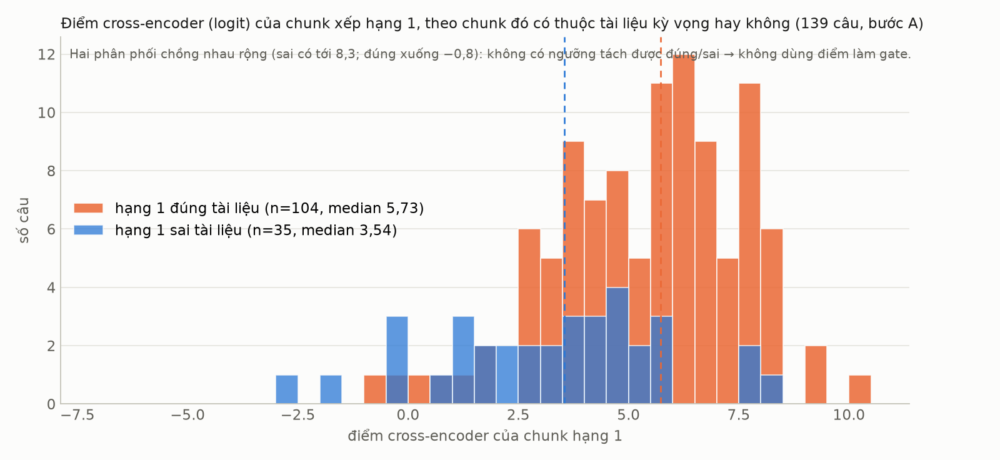
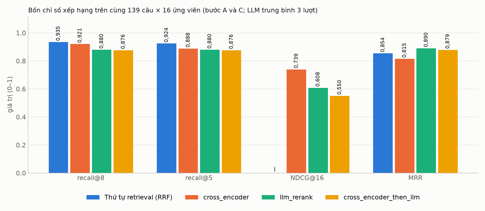
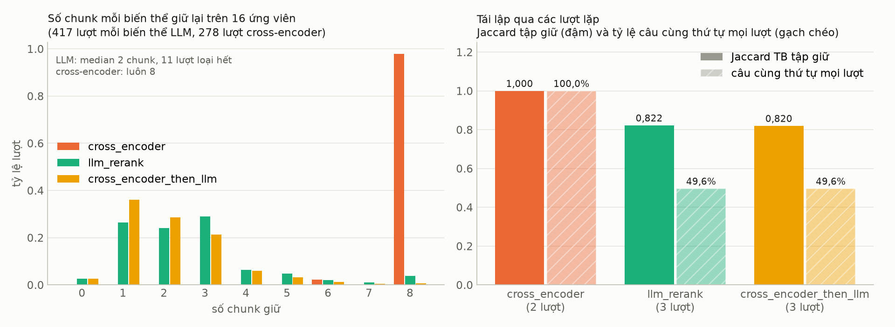
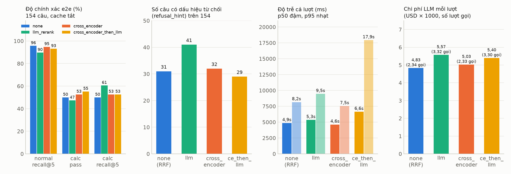
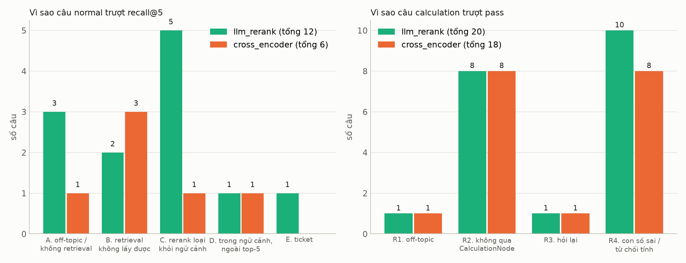

# Báo cáo benchmark: cross-encoder so với LLM rerank (UNISAGE-106)

Ngày đo: 26/10/2026 (giờ VN 10:00–12:40) · Máy: Linux dev, RTX 4080 SUPER 16 GB, driver 595.91.07,
CUDA 13 · Nhánh: `feature/huydh-unisage-106-benchmark-cross-encoder` · Spec:
`docs/specs/SPEC-cross-encoder-rerank.md` · Cách chạy lại: `docs/guide/benchmark-rerank.md`.

Câu hỏi của ticket: thay bước 09a (LLM rerank) bằng cross-encoder `BAAI/bge-reranker-v2-m3`
chạy local, hoặc đặt cross-encoder trước LLM rerank, có **giảm độ trễ mà giữ (hoặc tăng) độ
chính xác** không.

Mỗi bảng dưới đây đi kèm ba phần: **đo gì**, **đọc ra gì**, **dùng để quyết định gì**. Thuật ngữ
trong các bảng: mục 0.

---

## 0. Bảng thuật ngữ dùng trong các bảng

### 0.1. Chỉ số xếp hạng (bước rerank, mục 3 và 5)

| Từ khoá | Nghĩa | Đọc thế nào |
|---|---|---|
| ứng viên (candidates) | 16 chunk retrieval trả về cho một câu (theo thứ tự RRF), đầu vào chung của mọi biến thể | mọi biến thể chỉ được chọn trong 16 chunk này |
| chunk | một đoạn tài liệu đã cắt khi ingest (heading_path + nội dung), đơn vị của retrieval và rerank | một tài liệu có nhiều chunk; nhiều chunk cùng `document_id` |
| document_id / tài liệu kỳ vọng | mã tài liệu gốc; `expected_document_ids` là tài liệu mà đáp án nằm trong đó (ground truth của eval) | chunk "đúng" = chunk thuộc tài liệu kỳ vọng |
| kept / tập giữ | danh sách chunk biến thể trả ra sau rerank, theo thứ tự nó xếp | đây là thứ prompt sinh câu trả lời đọc (tối đa 8) |
| recall@k | phần tài liệu kỳ vọng xuất hiện trong k chunk giữ đầu; câu có 2 tài liệu kỳ vọng mà chỉ có 1 → 0,5 | 1,0 = đủ tài liệu; chỉ số chính vì tài liệu không vào prompt thì không có câu trả lời |
| recall@8 / recall@5 | recall@k với k = 8 (= `CHAT_CONTEXT_MAX_CHUNKS`, số chunk prompt đọc) và k = 5 (khớp eval e2e) | |
| MRR | trung bình của 1/hạng của chunk đúng đầu tiên (hạng 1 → 1; hạng 2 → 0,5; không có → 0) | đo tài liệu đúng nằm cao đến đâu, không đo giữ được bao nhiêu |
| NDCG@16 | DCG của danh sách giữ (mỗi chunk đúng ở hạng r cộng 1/log2(r+1)) chia cho DCG lý tưởng (mọi chunk đúng trong 16 ứng viên xếp lên đầu) | đo cả thứ tự lẫn số lượng chunk đúng; phạt biến thể giữ ít |
| Loại hết (empty) | tỷ lệ lượt biến thể không giữ chunk nào | trong graph thật → web search / "chưa có thông tin" / ticket |
| Giữ TB | số chunk giữ trung bình mỗi lượt | cross-encoder luôn 8; LLM median 2 |
| Lỗi | lượt biến thể không trả kết quả (service lỗi, model lỗi, JSON hỏng, rate limit) | trong benchmark không fail-open; trong graph thật thì fail-open |
| Lượt | số lần chạy = số câu × số lần lặp (cross-encoder 2, LLM 3) | |
| mốc không rerank | lấy 8 chunk đầu theo thứ tự retrieval, không rerank gì | mức mà bước rerank phải vượt để có ích |
| trần (ceiling) | recall cao nhất có thể khi chỉ chọn trong 16 ứng viên = tài liệu kỳ vọng có trong 16 ứng viên | không biến thể nào vượt được; 0,928 trên bộ ứng viên fetch lại |
| RRF | Reciprocal Rank Fusion: cách hybrid trộn danh sách dense và BM25 (điểm = Σ 1/(k + hạng)) | thứ tự "retrieval" trong báo cáo là thứ tự RRF |
| dense / cosine | tìm theo vector ngữ nghĩa, điểm cosine 0–1 (`score` của chunk) | 0,70 là điểm gán cho chunk chỉ BM25 tìm thấy |
| BM25 / hybrid | tìm theo từ khoá; hybrid = dense + BM25 trộn bằng RRF | bật qua `RETRIEVAL_HYBRID_ENABLED` |
| điểm CE / logit | đầu ra của cross-encoder cho một cặp (câu hỏi, chunk), số thực không chặn (âm được), càng cao càng liên quan | chỉ so trong cùng một câu, không so giữa các câu |
| K / `CHAT_CROSS_ENCODER_KEEP` | số chunk cross-encoder giữ mỗi sub-query (8) | |
| sub-query | câu hỏi con sau khi decomposer tách (1–3 mỗi lượt); benchmark dùng sub-query đầu | |
| rescue rule | trong `llm_rerank`: khi LLM loại hết ở mọi sub-query, sub-query có chunk cosine ≥ 0,75 được giữ lại top-2 | giải thích vì sao một số câu "loại hết" không được cứu (cosine < 0,75) |
| Jaccard TB tập giữ | trung bình |A∩B|/|A∪B| của tập chunk giữ giữa các lần lặp | 1,0 = lần nào cũng giữ y hệt |
| Cùng thứ tự | tỷ lệ câu mà mọi lần lặp cho đúng cùng danh sách, cùng thứ tự | thước đo tái lập |
| Lệch recall@8 | trung bình (max − min) recall@8 của một câu qua các lần lặp | dao động của kết quả theo lần chạy |
| `truncated` | số passage dài hơn `RERANKER_MAX_LENGTH` (1024 token) bị service cắt | 0 trong mọi lần đo |
| FP16 | model chạy ở số thực 16 bit trên GPU | nhanh, ít VRAM, điểm gần như không đổi |

### 0.2. Chỉ số hiệu năng (mục 4 và 6)

| Từ khoá | Nghĩa |
|---|---|
| p50 / p95 / p99 | phân vị: 50 % / 95 % / 99 % số phép đo nhanh hơn giá trị này; p50 = median, p95 = "trường hợp xấu thường gặp" |
| TB / Max | trung bình / lớn nhất |
| Phép đo | số request đã đo (sau warm-up) |
| warm-up | các request đầu bị bỏ, để model/cache nóng lên không làm méo số |
| vòng (iterations) | số lần lặp qua toàn bộ câu ở `-p` |
| req/s (throughput) | số request hoàn thành mỗi giây trong vòng đo |
| Đồng thời (concurrency) | số request bắn cùng lúc qua `asyncio.Semaphore` ở `-c` |
| CPU TB % | % CPU toàn máy trung bình trong vòng đo (psutil) |
| RAM đỉnh GB | RAM toàn máy dùng cao nhất trong vòng đo |
| VRAM đỉnh MiB | bộ nhớ GPU dùng cao nhất theo `nvidia-smi` (toàn GPU, gồm cả tiến trình khác) |
| GPU TB % | mức bận của GPU trung bình theo `nvidia-smi` |
| VRAM trước / sau | `nvidia-smi` trước khi spawn service và sau khi tắt; "đã nhả" khi về trong ±150 MiB |
| rate limit / maxRpm | giới hạn lượt gọi mỗi phút của một credential LLM (RERANK của eval: 15) |
| giãn cách (`--llm-rpm`) | harness tự chờ để không vượt maxRpm; thời gian chờ không tính vào độ trễ |

### 0.3. Chỉ số tầng câu trả lời (mục 7, từ `evals/run/metrics.py`)

| Từ khoá | Nghĩa |
|---|---|
| recall@5 (e2e) | tài liệu kỳ vọng có trong 5 chunk đầu của ngữ cảnh đưa vào prompt; nhánh calculation không ghi ngữ cảnh nên tính trên trích dẫn của câu trả lời |
| fail / pending (normal) | fail = recall@5 sai hoặc không đi nhánh RAG; pending = chưa chấm nội dung (cần judge RAGAS) |
| pass (calculation) | câu đi qua CalculationNode, không hỏi lại, và các con số của đáp án kỳ vọng xuất hiện trong câu trả lời (`numbers_match`, khá dễ dãi) |
| outcome | nhánh đã đi: `rag`, `calculation`, `ticket`, `off_topic`... |
| refusal_hint | câu trả lời chứa mẫu "chưa có thông tin / không thể hỗ trợ" |
| ticket fallback | lượt kết thúc bằng TicketFallbackNode (gợi ý tạo ticket) |
| citation accuracy | phần trích dẫn [n] trong câu trả lời trỏ đúng tài liệu kỳ vọng |
| TTFT | time to first token: từ lúc gửi câu hỏi tới token đầu tiên của câu trả lời |
| total_ms | thời gian cả lượt, từ gửi tới token cuối |
| usage: calls / token vào / USD | số lượt gọi LLM, token đầu vào, chi phí ước tính mỗi lượt chat (mọi bước: phân loại, HyDE, rerank, sinh) |
| LLM_RERANK_FAILED | cảnh báo AI admin khi LLM rerank lỗi và graph fail-open về xếp theo điểm |
| CROSS_ENCODER_FAILED | cảnh báo khi service cross-encoder lỗi và graph fail-over sang LLM rerank |
| fail-open | lỗi thì giữ kết quả trước đó (xếp theo điểm) và đi tiếp |
| fail-over | lỗi thì chuyển sang cơ chế dự phòng (LLM rerank) |
| cache tắt | `RETRIEVAL_CACHE_REDIS_URL=` trống, để mọi lượt đều retrieval + rerank thật |

---

## 1. Kết luận

### 1.1. Đối chiếu 5 tiêu chí thành công của spec (`SPEC-cross-encoder-rerank.md`, mục Success Criteria)

| # | Tiêu chí trong spec | Số đo | Kết luận |
|---|---|---|---|
| 1 | P95 bước rerank `cross_encoder` < 500 ms trên 3060 (kỳ vọng < 200 ms trên 4080), 16 ứng viên, concurrency 4 không OOM, hàng đợi không tăng | 4080: p95 **147 ms** (695 phép đo); concurrency 4: p95 542 ms, 0 lỗi, VRAM đỉnh 2 987 MiB không đổi theo mức đồng thời; throughput phẳng ~7,3 req/s (không có hàng đợi tích luỹ) | **Đạt trên 4080**; 3060 chưa đo (ước p95 ~350 ms, mục 9) |
| 2 | recall@8 `cross_encoder` ≥ `llm_rerank` − 1 điểm trên bộ demo; **NDCG@16 và MRR không thấp hơn** | recall@8 **0,921 so với 0,880** (+4,1); NDCG@16 **0,739 so với 0,608** (+13); MRR **0,815 so với 0,890 (−7,5)** | **Đạt một phần**: recall@8 và NDCG đạt, **MRR không đạt**. Lý do ở 1.2 |
| 3 | Ổn định: cross-encoder cho cùng thứ tự qua các lần chạy; ghi được mức dao động của LLM rerank | cross-encoder 139/139 câu cùng thứ tự ở 2 lượt; LLM rerank Jaccard 0,82, chỉ 49,6 % câu cùng tập giữ qua 3 lượt | **Đạt** |
| 4 | Tầng câu trả lời: recall@5 và pass calculation của `cross_encoder` ≥ `llm` − 1 điểm; ticket fallback không tăng; p95 toàn lượt giảm | normal recall@5 **110/116 so với 104/116** (+6); calculation pass **20/38 so với 18/38** (+2); **calculation recall@5 20/38 so với 23/38 (−3)**; ticket 0 so với 1; p95 7,5 s so với 9,5 s | **Đạt một phần**: 4/5 ý đạt, **calculation recall@5 không đạt**. Lý do ở 1.2 |
| 5 | `nvidia-smi` sau benchmark không còn tiến trình do benchmark tạo; VRAM về mức trước | 494 → 1 839 (service) → 494 MiB ở mọi lần chạy; lần bước D còn 1 435 MiB là của hai tiến trình dự án khác | **Đạt** |

Tổng: 3 tiêu chí đạt trọn, 2 tiêu chí đạt một phần (mỗi tiêu chí hụt đúng một ý phụ). Không có
tiêu chí nào trượt ở ý chính (độ trễ, recall@8, recall@5 normal, pass calculation, VRAM).

### 1.2. Hai ý không đạt và vì sao

**MRR 0,815 so với 0,890 (tiêu chí 2).** MRR = 1/hạng của chunk đúng đầu tiên. LLM rerank chỉ giữ
median 2 chunk và khi nó giữ được tài liệu đúng thì gần như luôn đặt ở hạng 1 (recall@1 0,829);
cross-encoder giữ đủ 8 và ở 23 câu đặt chunk đúng ở hạng 2–4 (recall@1 0,712, thấp hơn cả thứ
tự retrieval 0,745). Nói cách khác, cross-encoder **không xếp tốt hơn RRF ở hạng 1**, nó chỉ
*không loại nhầm* như LLM. MRR của LLM còn được "lợi" bởi cách tính: 12 câu LLM loại hết tài
liệu đúng cho MRR = 0 nhưng kéo trung bình xuống ít hơn so với việc cross-encoder xếp đúng ở
hạng 3 ở nhiều câu. Hệ quả thực tế: ở tầng câu trả lời (prompt đọc cả 8 chunk) MRR thấp hơn
**không** làm giảm số câu trả lời đúng (normal 110 so với 104), nhưng với một model sinh nhạy
thứ tự hơn gpt-5-mini/gemini-flash thì có thể. Cách khắc phục nếu cần: dùng cross-encoder để
xếp nhưng giữ nguyên chunk hạng 1 của RRF khi điểm cross-encoder của nó không thua top-1 quá
một ngưỡng; chưa làm trong ticket này.

**Calculation recall@5 20/38 so với 23/38 (tiêu chí 4).** Nhánh calculation không ghi ngữ cảnh,
eval tính recall@5 trên **trích dẫn** trong câu trả lời. 6 câu từ đúng thành sai (d0244, d0311,
d0319, d0326, d0327, d0335) đều có `citations: []` ở run cross-encoder trong khi 4/6 câu trả lời
**cùng con số** với run gốc (d0327 "Còn 335 chỗ", d0311, d0326, d0335); 3 câu từ sai thành đúng
(d0243, d0328, d0336). Chỉ số `pass` (đúng con số, không cần trích dẫn) lại tăng 18 → 20 và số
câu từ chối giảm 10 → 5. Nghĩa là tài liệu vào prompt tính toán vẫn đủ, nhưng model tính toán
**bớt gắn số trích dẫn** khi danh sách chunk được cross-encoder xếp lại. Giả thuyết: nhánh
calculation cắt `LLM_CHUNKS_LIMIT` chunk đầu sau rerank; cross-encoder đưa nhiều chunk cùng tài
liệu lên trên (8/8 chunk cùng một tài liệu ở d0033, d0217) nên chunk mang số liệu cụ thể rơi
xuống dưới giới hạn, model trả lời từ số đã có trong câu hỏi mà không trích. Cần một ticket nhỏ
để xác nhận (ghi `context` ở nhánh calculation rồi so). Đánh giá: không mất chất lượng câu trả
lời, mất khả năng kiểm chứng nguồn; là lỗi cần sửa trước khi bật mặc định cho nhánh calculation,
hoặc tạm giữ `llm` riêng cho nhánh này (graph đã tách hai chỗ gọi, đổi được độc lập).

### 1.2b. Số liệu đã đủ chứng minh cross-encoder thay được LLM rerank chưa

Đủ để kết luận "thay được mà không xấu đi" trên corpus demo; chưa đủ để nói "tốt hơn một cách
chắc chắn" hay khái quát sang corpus khác.

**Đã chứng minh được**

| Khía cạnh | Bằng chứng | Mức tin cậy |
|---|---|---|
| Bước rerank không mất tài liệu đúng so với LLM | cùng 139 câu, cùng 16 ứng viên: recall@8 0,921 so với 0,880, chênh +4,1 điểm = 12 câu LLM loại nhầm; LLM lặp 3 lượt, lệch recall@8 giữa các lượt chỉ 0,018 | cao: chênh lớn hơn nhiễu lặp nhiều lần, cùng đầu vào (mục 5) |
| Tầng câu trả lời không xấu đi | normal recall@5 110 so với 104, từ chối 32 so với 41, ticket 0 so với 1, calculation pass 20 so với 18 | trung bình: một lần chạy mỗi chế độ, nhiễu nền của eval khoảng ±2 câu, nhưng chênh +6 câu normal và −9 từ chối vượt mức đó (mục 7) |
| Nhanh hơn, rẻ hơn, ổn định hơn | 0,11 s so với 1,7 s (695 và 139 phép đo), −10 % chi phí, tái lập 100 % so với 49,6 % | cao (mục 4, 5, 6) |
| Không rò VRAM, chịu tải đủ cho tải hiện tại | 494 → 494 MiB mọi lần; 7,3 req/s | cao trên 4080, 3060 chưa đo (mục 4, 9) |

**Chưa chứng minh được, và vì sao**

| Khoảng trống | Vì sao | Cần gì để lấp |
|---|---|---|
| "Tốt hơn" ở tầng câu trả lời chưa có độ tin cậy thống kê | 154 câu, một lần chạy mỗi chế độ; model sinh tự dao động ±2 câu giữa hai lần chạy cùng cấu hình (35 câu đổi trạng thái giữa `none` và `cross_encoder` dù hai chế độ tương đương, mục 7.7) | lặp e2e 3 lần mỗi chế độ, hoặc bộ official lớn hơn |
| Mốc LLM bị pha | 70/154 lượt của run gốc LLM rerank lỗi rate limit và fail-open: "LLM hiện tại" ở e2e thực ra là 55 % LLM + 45 % xếp theo điểm; mốc LLM sạch chỉ có ở bước rerank (bước C), nơi cross-encoder vẫn hơn | nâng maxRpm hoặc thêm credential RERANK rồi chạy lại `llm` |
| Một corpus | hybrid retrieval ở bộ demo chạm trần (recall@8 0,928); trên bộ official hoặc câu hỏi thật, vị trí của cross-encoder và LLM có thể đổi | e2e trên bộ official với `none`, `cross_encoder`, `llm` |
| Hai điểm yếu chưa định lượng tần suất ngoài eval | bảng toàn tên riêng (d0010), tài liệu trùng tiêu đề; mất gate web search | theo dõi log sau khi bật; gate thay thế trước khi bật web search |
| Trích dẫn nhánh calculation giảm | recall@5 theo trích dẫn 20 so với 23, con số trả lời vẫn đúng hơn, chưa rõ nguyên nhân (mục 7.4) | ghi `context` ở nhánh calculation rồi so |

**Kết luận thực dụng**: số liệu đủ để **bỏ LLM rerank** ở bộ demo một cách an toàn; nếu phải chọn
giữa cross-encoder và LLM, cross-encoder thắng ở mọi trục trừ MRR. Nhưng cùng bộ số liệu cho thấy
`none` bằng cross-encoder (mục 7.7), nên câu hỏi để triển khai không còn là "cross-encoder thay LLM
được chưa" mà là "có cần rerank không". Ba việc còn thiếu theo thứ tự giá trị: e2e trên bộ
official với ba chế độ; lặp bộ demo thêm 2 lần để có khoảng tin cậy; đo trên 3060 nếu chọn
cross-encoder.

### 1.3. Khuyến nghị

**Kết quả mạnh nhất của benchmark không phải "cross-encoder thắng LLM" mà là "trên corpus này
bước rerank không còn việc để làm".** Thứ tự RRF của hybrid retrieval đã chạm trần của bộ ứng
viên; mọi bộ rerank chỉ có thể giữ nguyên hoặc làm hỏng. Bốn chế độ ở tầng câu trả lời, cùng
154 câu (mục 7, 7.7):

| | `none` (RRF, không rerank) | `cross_encoder` | `llm` (hiện tại) | `cross_encoder_then_llm` |
|---|---|---|---|---|
| normal recall@5 | **111/116** | 110/116 | 104/116 | 108/116 |
| calculation pass | 19/37 (*) | **20/38** | 18/38 | **21/38** |
| Từ chối trả lời | 31 | 32 | 41 | **29** |
| Ticket fallback | 0 | 0 | 1 | 1 |
| Cả lượt p50 / p95 | 4,9 s / 8,2 s (*) | **4,6 s / 7,5 s** | 5,3 s / 9,5 s | 6,6 s / 17,9 s |
| USD / lượt | **0,00483** | 0,00503 | 0,00557 | 0,00540 |
| Cần gì thêm | không gì | GPU 2,5 GB + service | API + rate limit | cả hai |

(*) `none` có 1 lượt lỗi 504 của model sinh (d0316, 33 s) không liên quan rerank; bỏ lượt đó
pass là 19/37 và p95 ~7,9 s.

`none` và `cross_encoder` **hoà trong mức nhiễu** (±1–2 câu, mức dao động của chính model sinh
giữa hai lần chạy). Cả hai hơn `llm` rõ: +6–7 câu normal, +1–2 pass calculation, −9–10 câu từ
chối, −10–13 % chi phí, nhanh hơn 0,5–0,7 s mỗi lượt.

**Khuyến nghị theo thứ tự:**

1. **Đặt `CHAT_RERANK_MODE=none` làm mặc định** ở mọi môi trường: bằng cross-encoder về chất
   lượng, rẻ nhất, không cần GPU, không thêm tiến trình, không có gì để hỏng. Bước 09a trở thành
   "sàn cosine 0,45 rồi lấy 8 chunk đầu theo RRF".
2. **Giữ service cross-encoder và chế độ `cross_encoder` như lựa chọn** cho corpus/câu hỏi mà
   retrieval xếp kém hơn (hình 1: cross-encoder chỉ có chỗ phát huy khi đường RRF chưa chạm
   trần), hoặc khi cần điểm liên quan làm tín hiệu cho web search sau này. Bật khi có số đo trên
   corpus đó, không bật theo mặc định.
3. **Tắt LLM rerank** trừ khi có lý do khác ngoài độ chính xác: nó là chế độ kém nhất ở mọi cột
   trừ MRR, không ổn định (49,6 % tái lập) và phụ thuộc rate limit.
4. **Không triển khai `cross_encoder_then_llm`.**

**Điều kiện và việc cần làm trước khi đổi mặc định** (chi tiết mục 8):

1. Web search: cả `none` lẫn `cross_encoder` đều không có gate "không tài liệu nào trả lời";
   khi bật lại `CHAT_WEB_SEARCH_ENABLED` cần một gate khác (ví dụ cosine top-1 < ngưỡng).
2. Trích dẫn ở nhánh calculation (mục 7.4): cả hai chế độ không-LLM đều bớt gắn trích dẫn
   (recall@5 calculation 19–20 so với 23); câu trả lời không đổi nhưng cần sửa trước khi bật cho
   nhánh này, hoặc giữ `llm` riêng cho Calculation.
3. Đo lại trên một corpus thứ hai (bộ official) trước khi khái quát "không cần rerank".
4. Sửa rate limit của credential RERANK/Extraction (maxRpm 15) độc lập với ticket này.

---

## 2. Cách đo

### 2.1. Bộ ứng viên chung cho benchmark bước rerank (bước A–D)

- Nguồn: `runs/hybrid-on` (eval 21/10/2026, bộ demo, category normal + calculation, hybrid
  BM25 + dense bật, cache tắt, web off, variant exact). Mỗi câu lấy câu hỏi độc lập của
  sub-query đầu và đúng 16 `chunk_id` retrieval đã trả về theo thứ tự RRF; nội dung chunk fetch
  lại từ Qdrant collection `unisage_eval_chunks` (collection run đó dùng) với filter quyền của
  lượt (bộ demo toàn guest → chỉ tài liệu public).
- Dùng được **139/154** câu: 15 câu không có retrieval (greeting/off-topic/clarification);
  37/2 224 chunk ghi trong run không còn trong collection (tài liệu đã xoá/ingest lại), câu vẫn
  dùng với các chunk còn lại. 117 câu có 16 ứng viên, 19 câu có 8, 3 câu có 6.
- Ground truth: `expected_document_ids` của câu. Một chunk "đúng" khi `document_id` của nó nằm
  trong tập kỳ vọng. 130 câu có 1 tài liệu kỳ vọng, 9 câu có 2.
- **Trần**: tài liệu kỳ vọng có mặt trong các ứng viên fetch lại được ở mức recall **0,928**
  (0,935 nếu tính cả 37 chunk đã ghi nhưng không còn trong collection; mọi biến thể chỉ thấy
  bộ fetch lại nên dùng 0,928). Không biến thể nào vượt được số này: 5 câu (d0040, d0225, d0242,
  d0296, d0324) không có tài liệu kỳ vọng trong ứng viên; 9 câu có 2 tài liệu kỳ vọng nhưng
  retrieval chỉ lấy được 1.
- **Mốc không rerank** (biến thể `none` của harness, = `CHAT_RERANK_MODE=none`): lấy 8 chunk đầu
  theo thứ tự retrieval → recall@8 **0,928 (= trần)**, recall@5 0,917, NDCG@16 0,733, MRR 0,846.
  Mọi bước rerank phải so với mốc này: trên bộ này thứ tự RRF của hybrid đã đưa tài liệu đúng
  vào top-8 ở mọi câu có thể.

### 2.2. Ba biến thể, một chữ ký `select(candidate) -> kept`

| Biến thể | Làm gì với 16 ứng viên | Số chunk ra | Gọi gì |
|---|---|---|---|
| `cross_encoder` | service chấm 16 cặp (câu hỏi, heading_path + nội dung), giữ top-8 theo điểm | luôn 8 | 1 HTTP local |
| `llm_rerank` | `llm_rerank` thật của graph (model purpose RERANK = `openai:gpt-5-mini`), giữ chunk model nói "trả lời câu hỏi", có rescue rule | 0–8 | 1 lượt LLM |
| `cross_encoder_then_llm` | cross-encoder cắt 16 → 8, rồi `llm_rerank` trên 8 chunk đó | 0–8 | 1 HTTP + 1 lượt LLM |

Lỗi của biến thể (service/model không trả kết quả) tính là lỗi, **không** fail-open về danh
sách gốc như graph thật, để số đo không được "tặng" điểm của retrieval.

### 2.3. Chỉ số bước rerank

| Chỉ số | Đo gì | Khi nào quan trọng |
|---|---|---|
| recall@8 | phần tài liệu kỳ vọng có trong 8 chunk giữ đầu (8 = `CHAT_CONTEXT_MAX_CHUNKS`, đúng số chunk prompt sinh câu trả lời nhìn thấy) | chỉ số chính: tài liệu không vào prompt thì không có câu trả lời |
| recall@5 | như trên với 5 | so với `recall@5` của eval e2e |
| MRR | 1/hạng của chunk đúng đầu tiên | khi model sinh ưu tiên chunk đầu; ít quan trọng hơn recall@8 vì prompt đọc cả 8 |
| NDCG@16 | nhị phân theo document_id, lý tưởng = mọi chunk đúng trong 16 ứng viên xếp trước | phạt cả xếp sai lẫn bỏ bớt chunk đúng; bất lợi cho biến thể giữ ít chunk |
| Loại hết | câu không còn chunk nào sau rerank | trong graph thật → web search / ticket / "chưa có thông tin" |
| Giữ TB | số chunk ra trung bình | giải thích vì sao NDCG và recall của LLM thấp |
| Ổn định | 3 lượt lặp: Jaccard trung bình của tập giữ, tỷ lệ câu cùng thứ tự cả 3 lượt, lệch recall@8 | có tái lập được kết quả eval không |
| p50/p95 ms | riêng bước rerank, đo trong harness (gồm HTTP tới service hoặc API LLM), **không** tính thời gian chờ rate limit | phần độ trễ ticket này muốn cắt |

### 2.4. Bước E, tầng câu trả lời

Chạy lại toàn bộ graph (`task eval:run env=eval -- --set demo --category normal --category
calculation --variant exact --web off`, cache tắt bằng `RETRIEVAL_CACHE_REDIS_URL=` trống, 3
lượt song song) với `CHAT_RERANK_MODE=cross_encoder` (`runs/ce-on`) và
`cross_encoder_then_llm` (`runs/ce-then-llm`), so với `runs/hybrid-on` (chế độ `llm`, cùng
lệnh, 21/10). Chỉ số của eval: `recall@5` (tài liệu kỳ vọng trong 5 chunk đầu của ngữ cảnh,
hoặc trong trích dẫn với nhánh calculation), `pass` (calculation: số đúng), `refusal_hint`
(câu trả lời chứa dấu hiệu "chưa có thông tin"), ticket fallback, `citation_accuracy`,
`total_ms`/`ttft_ms` toàn lượt, usage (số lượt gọi LLM, token, USD).

### 2.5. Điều kiện môi trường cần biết khi đọc số

- Credential RERANK (và Extraction) của eval giới hạn **15 lượt/phút**. Harness bước C–D giãn
  cách 14 lượt/phút (`--llm-rpm`) nên số đo bước rerank của LLM sạch; eval e2e (bước E và run
  gốc) chạy 3 lượt song song nên LLM rerank **lỗi rate limit và fail-open** ở 70/154 lượt của
  `hybrid-on` và 32/154 lượt của `ce-then-llm`. Nghĩa là "mốc LLM" ở tầng câu trả lời thực tế là
  hỗn hợp 55 % LLM rerank + 45 % xếp theo điểm; và độ trễ e2e của hai chế độ có LLM bị cộng thời
  gian chờ slot.
- VRAM: harness không nạp model; nó spawn service, đo, tắt ở `finally`, chờ `nvidia-smi` về mức
  cũ. Mọi lần: trước 494 MiB → service nạp model 1 839 MiB → sau khi tắt 494 MiB. Riêng lần bước
  D ghi "sau khi tắt 1 435 MiB" vì hai tiến trình `vya-ocr-exp` (936 MiB) và `vya-ocr-staging`
  (484 MiB) của dự án khác khởi động trong lúc đo; service đã gỡ model (log "reranker unloaded").

---

## 3. Bước A — Accuracy cross-encoder (`-a --variant cross_encoder`)

Báo cáo gốc: `benchmark_results/step-a-ce-accuracy/` (gitignore). 2 lượt × 139 câu, 30 giây.

| Biến thể | Nhóm | Câu | Lượt | recall@8 | recall@5 | NDCG@16 | MRR | Loại hết | Giữ TB | Lỗi | p50 ms | p95 ms |
|---|---|---|---|---|---|---|---|---|---|---|---|---|
| none (mốc không rerank) | tất cả | 139 | 278 | 0.928 | 0.917 | 0.733 | 0.846 | 0.0% | 8.0 | 0 | 0 | 0 |
| cross_encoder | tất cả | 139 | 278 | 0.921 | 0.888 | 0.739 | 0.815 | 0.0% | 8.0 | 0 | 111 | 147 |
| cross_encoder | calculation | 26 | 52 | 0.923 | 0.923 | 0.740 | 0.849 | 0.0% | 8.0 | 0 | 103 | 136 |
| cross_encoder | normal | 113 | 226 | 0.920 | 0.881 | 0.739 | 0.807 | 0.0% | 7.9 | 0 | 111 | 149 |

Tất định: 2 lượt cho cùng thứ tự ở 139/139 câu (Jaccard 1,000, lệch recall 0).

Đường cong recall@k (trung bình 139 câu), để chọn K:

| k | 1 | 2 | 3 | 4 | 5 | 6 | 7 | 8 |
|---|---|---|---|---|---|---|---|---|
| thứ tự retrieval (RRF) = `none` | 0.745 | 0.831 | 0.860 | 0.896 | 0.917 | 0.924 | 0.928 | 0.928 |
| cross_encoder | 0.712 | 0.766 | 0.831 | 0.871 | 0.888 | 0.906 | 0.914 | 0.921 |


*Hình 1. recall@k (k = 1..8) trên cùng 16 ứng viên của 139 câu. Đường xanh dương là thứ tự
retrieval không rerank, chạm trần 0,928 từ k = 7. Cross-encoder (cam) xuất phát thấp hơn ở k = 1
nhưng tiến gần trần ở k = 8. Hai biến thể LLM (lục, vàng) cao nhất ở k = 1–2 rồi phẳng từ k = 3 vì
chúng chỉ giữ median 2 chunk: phần tài liệu đúng bị loại không bao giờ quay lại dù k tăng. Số của
hai đường LLM lấy từ bước C (mục 5), vẽ chung để so.*

### 3.1. Các chỉ số ở mục này chứng minh điều gì

| Chỉ số | Dùng để chứng minh | Số đo | Kết luận rút ra |
|---|---|---|---|
| recall@8 so với **mốc không rerank** và **trần** | Cross-encoder có làm mất tài liệu đúng không khi thay LLM | 0,921 so với mốc 0,928 = trần 0,928 | Mất 0,7 điểm, do 2 câu cụ thể (d0010 bảng tên riêng, d0287 tài liệu trùng tên). Retrieval đã đưa tài liệu đúng vào top-8 ở mọi câu có thể, nên cross-encoder không có chỗ để thêm recall, chỉ có thể giữ hoặc làm rơi |
| recall@5, MRR, recall@1, đường cong recall@k | Cross-encoder xếp tài liệu đúng cao hơn hay thấp hơn thứ tự RRF | recall@1 0,712 so với 0,745; MRR 0,815 so với 0,846 | Xếp hạng 1 kém RRF một chút: cross-encoder không phải bộ xếp tốt hơn hybrid; giá trị của nó nằm ở chỗ không loại nhầm như LLM (mục 5) |
| Đường cong recall@k từ 1 đến 8 | Chọn K bao nhiêu là đủ | k = 6: 0,906; k = 8: 0,921 | Giữ K = 8; giảm K mất recall |
| Loại hết 0 %, Giữ TB 8,0 | Cross-encoder không bao giờ làm rỗng sub-query | 0/278 lượt | Mất gate "không tài liệu nào trả lời → web search"; hệ quả thiết kế, xử lý ở mục 8.2 |
| Jaccard 1,000, cùng thứ tự 100 % ở 2 lượt | Kết quả tất định, tái lập được | 139/139 câu | Eval chạy lại cho cùng số; không cần lặp nhiều lần như LLM |
| Phân phối điểm top-1 khi đúng và khi sai | Có dùng được điểm cross-encoder làm ngưỡng loại không | đúng: median 5,7, min −0,8; sai: median 3,5, max 8,3 | Hai phân phối chồng nhau, **không** dùng ngưỡng để loại, đúng với giả định spec |
| p50 111 ms, p95 147 ms | Chi phí thời gian của bước này so với LLM | so với 1,7 s ở mục 6 | Nhanh hơn 15 lần |

Mục này chứng minh cross-encoder **giữ được độ chính xác gần bằng retrieval gốc, chạy tất định và
nhanh**, nhưng **không xếp tốt hơn RRF** và **không có ngưỡng điểm đáng tin**. Nó chưa chứng minh
cross-encoder tốt hơn LLM rerank; việc đó cần mục 5 (so trực tiếp trên cùng 139 câu) và mục 7
(câu trả lời cuối).

Ba điều hay bị đọc nhầm ở mục này:

- **RRF có mặt vì nó là mốc "không rerank"**: thứ tự retrieval hybrid trả sẵn, miễn phí. Mọi bộ
  rerank phải so với nó; không hơn RRF thì bước rerank chỉ tốn thời gian. Trên corpus này RRF đã
  chạm trần từ k = 7, nên **rerank không thể tăng recall**, chỉ có thể giữ hoặc làm hỏng.
- **Trần 0,928 không phải "K = 8 thắng LLM"**: trần là giới hạn của bộ ứng viên (tài liệu kỳ vọng
  có trong các ứng viên fetch lại ở 92,8 % câu). Nó chỉ cho biết cross-encoder (0,921) còn cách
  tối đa 0,7 điểm, tức gần như không làm rơi gì.
- **Lập luận đúng để thay LLM**: "RRF đã gần tối ưu; cross-encoder giữ nguyên mức đó với 0,11 s;
  LLM rerank làm rơi 4 điểm recall@8 với 1,7 s" (số LLM ở mục 5, câu trả lời cuối ở mục 7). Hình 1
  vẽ chung bốn đường để nhìn một lần, nhưng hai đường LLM là số của mục 5.

**Đọc số**

- Cross-encoder **thấp hơn mốc không rerank** 0,7 điểm recall@8, 2,9 điểm recall@5 và 3,1 điểm
  MRR. Trên bộ này thứ tự RRF của hybrid đã xếp tài liệu đúng cao; cross-encoder xếp lại không
  thêm tài liệu nào (không thể, vì trần = mốc) mà làm rơi 2 câu và đẩy chunk đúng xuống vài
  hạng ở một số câu (recall@1 0,712 so với 0,745).
- 2 câu rơi (tài liệu đúng trong top-8 retrieval nhưng cross-encoder chấm ra ngoài):
  - **d0010** "đề tài triển khai an ninh mạng ... do giảng viên nào hướng dẫn": tài liệu đúng là
    bảng danh sách hội đồng poster (retrieval hạng 1–4, 6, 13, 14); cross-encoder cho điểm cao
    nhất −0,42 cho "Danh sách phản biện khóa luận" và đẩy mọi chunk của tài liệu đúng ra ngoài
    top-8. Bảng toàn tên riêng và mã đề tài không có "ngữ nghĩa" cho cross-encoder bám. Trong
    run gốc LLM rerank giữ đúng và trả lời đúng tên giảng viên, nhưng ở bước C LLM cũng 3/3
    lượt sai (mục 5.3) → câu khó cho cả hai.
  - **d0287** "điều kiện Đạt chứng chỉ ứng dụng CNTT": kỳ vọng là tài liệu "ca 2", cross-encoder
    giữ 5 chunk của "ca 1" và "phúc khảo" (cùng câu điều kiện). Metric theo document_id phạt;
    câu trả lời thực tế đúng. Lỗi áp lên mọi biến thể như nhau.
- 13 câu còn lại dưới 1,0 là do bộ ứng viên (trần 0,928), không phải lỗi rerank.
- Phân phối điểm (logit) của chunk top-1: khi đúng median 5,73 (min −0,83); khi sai median 3,54
  (max 8,28). Hai phân phối chồng nhau nhiều → **không** dùng ngưỡng điểm làm gate thay LLM
  (đúng giả định spec). Có thể dùng điểm để *ưu tiên* nhưng không để *loại*.
- Độ trễ 111 ms median cho 16 chunk thật, 103 ms cho câu calculation (ít ứng viên hơn).



*Hình 2. Điểm cross-encoder (logit) của chunk hạng 1 ở 139 câu, tách theo chunk đó có thuộc tài liệu
kỳ vọng không. Hai phân phối chồng nhau rộng: không có ngưỡng điểm nào tách được đúng/sai, nên
điểm chỉ dùng để xếp, không dùng để loại.*

**Dùng để quyết định**

- K = 8 giữ nguyên: từ k=6 (0,906) lên k=8 (0,921) vẫn còn +1,5 điểm; không có lý do giảm K.
- Cross-encoder không phải để "tăng recall" trên corpus này (retrieval đã tốt), mà để **thay LLM
  rerank với chi phí gần 0** (mục 5–7 cho thấy LLM rerank mới là thứ làm giảm recall).

---

## 4. Bước B — Performance và concurrency cross-encoder (`-p -c --variant cross_encoder`)

Báo cáo gốc: `benchmark_results/step-b-ce-perf/`.

Bảng 2 — warm-up 3, 5 vòng × 139 câu, concurrency 1:

| Biến thể | Phép đo | p10 | p25 | p50 | p75 | p90 | p95 | p99 | Max | TB | req/s | Lỗi | CPU TB % | RAM đỉnh GB | VRAM đỉnh MiB | GPU TB % |
|---|---|---|---|---|---|---|---|---|---|---|---|---|---|---|---|---|
| cross_encoder | 695 | 66 | 91 | 112 | 128 | 139 | 147 | 169 | 177 | 107 | 9.35 | 0 | 13.8 | 8.45 | 2987 | 80.7 |

Độ trễ theo số ứng viên (bước A, lượt 1): 6 ứng viên p50 35 ms, 8 ứng viên 66 ms, 16 ứng viên
116 ms (max 168 ms). Service báo `truncated=0` ở mọi request: không chunk nào vượt 1024 token.

Bảng 3 — 1 câu cố định `d0002` (16 ứng viên), 30 request mỗi mức:

| Đồng thời | p50 ms | p95 ms | req/s | Lỗi | VRAM đỉnh MiB | GPU TB % |
|---|---|---|---|---|---|---|
| 1 | 146 | 153 | 6.79 | 0% | 2987 | 84.9 |
| 2 | 269 | 272 | 7.36 | 0% | 2987 | 85.2 |
| 4 | 538 | 542 | 7.34 | 0% | 2987 | 86.2 |
| 8 | 1076 | 1085 | 7.26 | 0% | 2987 | 87.2 |


*Hình 3. Trái: phân phối 695 phép đo độ trễ bước rerank (concurrency 1), p50 112 ms, p95 147 ms,
không có đuôi dài. Giữa: p50/p95 tăng tuyến tính theo mức đồng thời (146 → 269 → 538 → 1076 ms).
Phải: throughput đứng ở ~7,3 req/s từ mức 2, dấu hiệu service xử lý tuần tự trên GPU.*

**Đọc số**

- Một lượt rerank 16 chunk thật mất **~110 ms** (p95 147 ms, p99 169 ms) trên 4080, so với 10 ms
  cho 16 passage ngắn ở test Task 1: chi phí tỉ lệ với **độ dài** chunk (corpus này chunk dài,
  nhiều cái sát 1024 token), không phải số passage. Phân phối hẹp (p10 66 → p99 169), không có
  đuôi dài: độ trễ dự đoán được.
- Service xử lý **tuần tự**: p50 tăng tuyến tính theo mức đồng thời (146 → 269 → 538 → 1076 ms)
  còn throughput đứng ở ~7,3 req/s; GPU đã bận 85 % nên nghẽn ở compute, không ở vòng lặp sự
  kiện. Muốn hơn phải gom nhiều request vào một lần forward (dynamic batching) hoặc thêm GPU.
- VRAM đỉnh 2 987 MiB khi chấm so với 1 839 MiB khi rảnh: activation của 16 cặp × 1024 token
  FP16 ≈ 1,1 GB. Tổng cần ~2,5 GB trống. RTX 3060 12 GB dư; `RERANKER_BATCH_SIZE=8` nếu muốn
  đỉnh thấp hơn (đổi lại chậm hơn ~10–20 %).
- Nhả VRAM: 494 → 494 MiB sau khi tắt, cả hai lần.

**Dùng để quyết định**

- Với tải chat hiện tại (dưới 1 lượt/giây) 7 req/s là dư 7 lần. Ngưỡng cần để ý: nếu có **≥ 4
  lượt chat cùng lúc** đến bước rerank, mỗi lượt đợi thêm ~0,5 s; ≥ 8 thì ~1 s, vẫn nhanh hơn LLM
  rerank (1,7 s) nhưng lợi thế co lại. Khi đó làm dynamic batching ở service (gom request trong
  10–20 ms thành một batch) trước khi nghĩ đến GPU thứ hai.
- Trên 3060 (≈ 40–45 % FLOPS FP16 của 4080 SUPER) kỳ vọng p50 ~250–300 ms, p95 ~350 ms: vẫn dưới
  500 ms, nhưng throughput chỉ ~3 req/s → với 4 lượt đồng thời đã ~1,3 s. Phải đo thật.

---

## 5. Bước C — Accuracy hai biến thể LLM (`-a --repeats 3`)

Báo cáo gốc: `benchmark_results/step-c-llm-accuracy/`. Model RERANK: `openai:gpt-5-mini`;
giãn cách 14 lượt/phút, 834 lượt gọi, 60 phút. Lần chạy đầu không giãn cách hỏng 404/417 lượt
vì rate limit, kết quả đó bị bỏ, không tính.

### 5.1. Bảng tổng (cùng 139 câu với bước A)

| Biến thể | Nhóm | Câu | Lượt | recall@8 | recall@5 | NDCG@16 | MRR | Loại hết | Giữ TB | Lỗi | p50 ms | p95 ms |
|---|---|---|---|---|---|---|---|---|---|---|---|---|
| none (mốc không rerank) | tất cả | 139 | 278 | 0.928 | 0.917 | 0.733 | 0.846 | 0.0% | 8.0 | 0 | 0 | 0 |
| cross_encoder | tất cả | 139 | 278 | 0.921 | 0.888 | 0.739 | 0.815 | 0.0% | 8.0 | 0 | 111 | 147 |
| llm_rerank | tất cả | 139 | 417 | 0.880 | 0.880 | 0.608 | 0.890 | 2.7% | 2.6 | 2 | 1819 | 3183 |
| llm_rerank | calculation | 26 | 78 | 0.922 | 0.922 | 0.641 | 0.883 | 3.9% | 3.0 | 1 | 1812 | 3415 |
| llm_rerank | normal | 113 | 339 | 0.870 | 0.870 | 0.600 | 0.891 | 2.4% | 2.5 | 1 | 1819 | 2989 |
| cross_encoder_then_llm | tất cả | 139 | 417 | 0.876 | 0.876 | 0.550 | 0.879 | 2.6% | 2.1 | 0 | 1753 | 2764 |
| cross_encoder_then_llm | calculation | 26 | 78 | 0.923 | 0.923 | 0.593 | 0.904 | 2.6% | 2.3 | 0 | 1717 | 3203 |
| cross_encoder_then_llm | normal | 113 | 339 | 0.866 | 0.866 | 0.541 | 0.873 | 2.7% | 2.1 | 0 | 1754 | 2651 |

Đường cong recall@k:

| k | 1 | 2 | 3 | 4 | 5 | 6 | 7 | 8 |
|---|---|---|---|---|---|---|---|---|
| thứ tự retrieval = `none` | 0.745 | 0.831 | 0.860 | 0.896 | 0.917 | 0.924 | 0.928 | 0.928 |
| cross_encoder | 0.712 | 0.766 | 0.831 | 0.871 | 0.888 | 0.906 | 0.914 | 0.921 |
| llm_rerank | 0.829 | 0.868 | 0.879 | 0.880 | 0.880 | 0.880 | 0.880 | 0.880 |
| cross_encoder_then_llm | 0.811 | 0.860 | 0.872 | 0.874 | 0.876 | 0.876 | 0.876 | 0.876 |

(Hình 1 ở mục 3 vẽ bốn đường này.)

Độ ổn định giữa 3 lượt:

| Biến thể | Jaccard TB tập giữ | Câu cùng thứ tự cả 3 lượt | Lệch recall@8 TB |
|---|---|---|---|
| cross_encoder (2 lượt) | 1.000 | 100.0% | 0.000 |
| llm_rerank | 0.822 | 49.6% | 0.018 |
| cross_encoder_then_llm | 0.820 | 49.6% | 0.011 |

Phân phối số chunk giữ (417 lượt): `llm_rerank` 0:11, 1:110, 2:100, 3:120, 4:26, 5:20, 6:8,
7:4, 8:16 (median 2); `cross_encoder_then_llm` 0:11, 1:150, 2:119, 3:89, 4:25, 5:13, 6:5, 7:2,
8:3 (median 2). Cross-encoder luôn 8.



*Hình 4. recall@8, recall@5, NDCG@16, MRR trên cùng 139 câu × 16 ứng viên. Cross-encoder cao nhất
ở recall và NDCG (giữ đủ 8 chunk); hai biến thể LLM cao nhất ở MRR (khi giữ được tài liệu đúng
thì đặt lên hạng 1) nhưng thấp ở recall vì loại nhầm. Thứ tự retrieval không có NDCG vì không
"chọn" gì.*



*Hình 5. Trái: LLM rerank giữ median 2 chunk (11 lượt loại hết), cross-encoder luôn 8: đây là gốc
của chênh lệch recall và NDCG. Phải: cross-encoder tái lập 100 %; hai biến thể LLM chỉ 49,6 % câu
cho cùng tập giữ qua 3 lượt (Jaccard 0,82).*

### 5.2. Đọc số

- **LLM rerank là bộ lọc, không phải bộ xếp**: giữ median 2 chunk trên 16. Vì thế recall@8 =
  recall@5 = recall@3 (0,880), đường cong phẳng từ k=3. Nó thấp hơn cross-encoder 4,1 điểm và
  mốc không rerank 4,8 điểm vì **loại bỏ** tài liệu đúng ở 12 câu mà cross-encoder còn giữ.
- **LLM xếp đúng hơn ở đầu danh sách**: recall@1 0,829 so với 0,712 của cross-encoder và 0,745
  của retrieval; MRR 0,890 so với 0,815. Khi LLM giữ được tài liệu đúng, nó đặt đúng chunk lên
  đầu. Giá trị này chỉ có nghĩa nếu model sinh chịu ảnh hưởng mạnh bởi thứ tự; với prompt 8
  chunk thì recall@8 quyết định nhiều hơn (mục 7 xác nhận: tầng câu trả lời theo cross-encoder
  tốt hơn).
- **NDCG@16 của LLM thấp** (0,61 / 0,55 so với 0,74) chủ yếu vì phạt "giữ ít": lý tưởng đếm mọi
  chunk đúng trong 16 ứng viên, LLM giữ 1–3 nên không bao giờ đạt. Không coi là bằng chứng LLM
  xếp sai.
- **11 lượt loại hết** ở mỗi biến thể LLM đều rơi vào 4 câu: d0022, d0221 (tài liệu đúng có
  trong ứng viên, cosine tốt nhất 0,66 / 0,56 < ngưỡng rescue 0,75 → không cứu), d0040, d0324
  (tài liệu đúng không có trong ứng viên, loại hết là đúng). Trong run gốc 3 câu ra "chưa có
  thông tin", 1 câu ra ticket. Cross-encoder không bao giờ loại hết → d0022, d0221 ở chế độ
  `cross_encoder` đưa tài liệu đúng vào prompt (và ở bước E d0022 vẫn không trả lời được: bản
  thân tài liệu không có số điện thoại; d0221 tương tự).
- **Không ổn định**: chỉ 49,6 % câu cho cùng tập giữ ở cả 3 lượt (Jaccard 0,82). Lệch recall@8
  trung bình nhỏ (0,018) vì phần lớn dao động là ở chunk phụ, nhưng có câu đổi hẳn kết quả giữa
  các lượt: d0022 (lượt 1–2 loại hết, lượt 3 giữ 4 chunk đúng), d0042 (lượt 1 đúng, lượt 2–3
  sai), d0224. Hệ quả thực tế: hai lần chạy eval cùng cấu hình có thể lệch nhau 1–2 câu chỉ vì
  LLM rerank; cross-encoder loại bỏ nguồn nhiễu này.
- **cross_encoder_then_llm không hơn llm_rerank** về độ chính xác (0,876 so với 0,880, trong
  nhiễu) và mất 2 câu do cross-encoder đã đẩy tài liệu xuống trước khi LLM thấy (d0036: chunk
  đúng ở hạng 6–8 sau cross-encoder, LLM 3/3 lượt chọn "Quyết định 1035"; d0022). Bù lại nó cứu
  d0050 (LLM thuần 3/3 lượt chọn sai "Bản mô tả CTĐT", LLM sau cross-encoder 3/3 chọn đúng "CTĐT
  Kiểm toán 2020") vì danh sách 8 ít nhiễu hơn 16. Tổng lại hoà; không đáng thêm một tầng.
- 2 lỗi của `llm_rerank` là model trả JSON hỏng (graph thật fail-open); 0 lỗi rate limit sau
  khi giãn cách.

### 5.3. 14 câu mà các biến thể cho kết quả khác nhau

recall@8 trung bình qua các lượt; "mốc" = 8 chunk đầu theo thứ tự retrieval.

| Câu | Mốc | CE | LLM | CE→LLM | Chuyện gì xảy ra |
|---|---|---|---|---|---|
| d0010 hội đồng poster, GV hướng dẫn đề tài an ninh mạng | 1.00 | 0.00 | 0.00 | 0.00 | Cả 3 chọn "Danh sách phản biện" thay vì "Danh sách hội đồng poster" (retrieval hạng 1–4). Run gốc trả lời đúng tên GV vì LLM rerank lúc đó giữ đúng; lần này 3/3 sai → kết quả LLM dao động giữa các lần. CE chấm −0,4 cho tài liệu sai, chunk đúng dưới top-8. Điểm yếu: bảng toàn tên riêng. |
| d0022 số điện thoại vướng mắc đăng ký nguyện vọng 2025 | 1.00 | 1.00 | 0.33 | 0.00 | CE giữ 2 chunk đúng (p3, p7). LLM 2/3 lượt loại hết, 1 lượt giữ 4 chunk đúng; CE→LLM 3/3 loại hết. Cosine cao nhất 0,66. |
| d0036 IUH Exchange Handbook 2019, nâng cấp khi nào | 1.00 | 1.00 | 1.00 | 0.00 | LLM thuần 3/3 giữ đúng p4 (hạng 4 retrieval). CE đẩy xuống hạng 6–8 (ưu tiên "Quyết định 1035", "Anti-terrorism plan" vì cùng chữ IUH tiếng Anh), LLM sau đó 3/3 chỉ giữ "Quyết định 1035". CE làm hại LLM. Ở tầng câu trả lời (mục 7) chế độ `cross_encoder` lại **đúng** vì prompt đọc cả 8 chunk. |
| d0042 điều kiện đạt chứng chỉ CNTT đợt 12/3/2022 | 1.00 | 1.00 | 0.33 | 0.67 | 4 tài liệu "Kết quả thi / phúc khảo" gần giống nhau. LLM lượt 1 giữ đúng, lượt 2–3 chỉ giữ "phúc khảo". |
| d0050 Kiểm toán cơ bản: học kỳ, tín chỉ, tiên quyết | 1.00 | 1.00 | 0.00 | 1.00 | Tài liệu đúng ở hạng 6 retrieval. LLM thuần 3/3 chọn "Bản mô tả CTĐT" (p43, p48, p53). CE xếp "CTĐT Kiểm toán 2020" lên top-8, LLM sau đó 3/3 giữ đúng. CE giúp LLM. Run gốc: "chưa có thông tin"; bước E chế độ `cross_encoder`: hết từ chối. |
| d0219 NCS có bằng thạc sĩ tích luỹ tối thiểu bao nhiêu tín chỉ | 1.00 | 1.00 | 0.50 | 0.50 | 2 tài liệu kỳ vọng (QĐ 1053 và QĐ 3177). LLM giữ 2 chunk của một tài liệu; CE giữ cả hai. |
| d0221 tổng đài hỗ trợ thí sinh | 0.50 | 0.50 | 0.00 | 0.00 | 2 kỳ vọng, retrieval lấy được 1. LLM 3/3 loại hết (cosine tốt nhất 0,56). CE giữ 3 chunk của tài liệu có. |
| d0224 Kiểm toán cơ bản học trước học phần nào | 0.50 | 0.50 | 0.17 | 0.00 | 2 kỳ vọng, 1 có (hạng 3). LLM lượt 1 giữ, lượt 2–3 không; CE→LLM 3/3 chọn "Bản mô tả" p43/p46. |
| d0227 pretest KHMT 20/12/2024 | 1.00 | 1.00 | 0.50 | 0.50 | 2 kỳ vọng; CE giữ cả hai, LLM chỉ giữ tài liệu khớp ngày. Run gốc trả lời đúng cả hai ý. |
| d0230 chuẩn đầu ra TCNH 2020 | 1.00 | 1.00 | 0.50 | 0.50 | 2 kỳ vọng; LLM chỉ giữ 1. |
| d0231 địa chỉ, giờ làm việc CDIMEX | 1.00 | 1.00 | 0.50 | 0.50 | 2 kỳ vọng; LLM chỉ giữ "Thông báo mua sách" (đủ trả lời đúng). |
| d0235 số tín chỉ Kiểm toán cơ bản | 1.00 | 1.00 | 0.50 | 0.50 | 2 kỳ vọng; LLM giữ 1. |
| d0236 mật khẩu mặc định thi thử tiếng Anh K22 | 1.00 | 1.00 | 1.00 | 0.67 | CE→LLM 2/3 lượt chỉ giữ tài liệu K22, bỏ K20. |
| d0287 điều kiện Đạt chứng chỉ CNTT | 1.00 | 0.00 | 0.00 | 0.00 | Kỳ vọng là "ca 2", cả 3 giữ "ca 1"/"phúc khảo" (cùng nội dung). Phạt do document_id. |

Nhóm 7 câu d0219–d0235 có **2 tài liệu kỳ vọng**: LLM rerank giữ một tài liệu đủ trả lời rồi
bỏ tài liệu còn lại, nên recall theo tài liệu 0,5 dù câu trả lời có thể vẫn đúng. Cross-encoder
giữ 8 nên giữ cả hai. Đây là nguồn chính của chênh lệch 4 điểm recall@8; câu hỏi "so sánh hai
văn bản" là nơi `cross_encoder` hơn hẳn.

**Dùng để quyết định**: nếu giữ LLM rerank thì phải chấp nhận ±1–2 câu nhiễu mỗi lần eval và
mất tài liệu thứ hai ở câu so sánh; nếu bỏ nó thì mất khả năng "không chunk nào trả lời → web
search" (xem 8.2).

---

## 6. Bước D — Độ trễ hai biến thể LLM (`-p --iterations 1 --warmup 2`)

Báo cáo gốc: `benchmark_results/step-d-llm-perf/`. 139 phép đo mỗi biến thể, concurrency 1,
chỉ tính thời gian lần gọi thành công (không tính giãn cách 14 lượt/phút).

| Biến thể | Phép đo | p10 | p25 | p50 | p75 | p90 | p95 | p99 | Max | TB | Lỗi | VRAM đỉnh MiB |
|---|---|---|---|---|---|---|---|---|---|---|---|---|
| cross_encoder (bước B) | 695 | 66 | 91 | 112 | 128 | 139 | 147 | 169 | 177 | 107 | 0 | 2987 |
| llm_rerank | 139 | 1290 | 1467 | 1696 | 2002 | 2508 | 3295 | 3745 | 3776 | 1834 | 0 | 1839 |
| cross_encoder_then_llm | 139 | 1290 | 1457 | 1698 | 1935 | 2226 | 2649 | 2934 | 4057 | 1742 | 0 | 4416 (*) |

(*) gồm 1 420 MiB của hai tiến trình dự án khác khởi động trong lúc đo (mục 2.5).


*Hình 6. Phân phối độ trễ riêng bước rerank (hộp = tứ phân vị, vạch = median, chấm = ngoại lệ).
Cross-encoder 0,11 s so với 1,7 s của hai biến thể LLM; `cross_encoder_then_llm` có đuôi p95 ngắn
hơn `llm_rerank` (2,6 s so với 3,3 s) vì LLM đọc 8 chunk thay vì 16.*

**Đọc số**

- Bước rerank bằng LLM mất **1,7 s median, 3,3 s p95** (gpt-5-mini, 16 chunk, prompt ~8–10k
  token); cross-encoder **0,11 s median, 0,15 s p95**: nhanh hơn **15 lần ở median, 22 lần ở
  p95**. Trên lượt chat p50 5,3 s của run gốc, đó là ~30 % thời gian.
- Trong run gốc, lượt mà LLM rerank chạy thật có p50 toàn lượt **6,2 s**, lượt nó lỗi và
  fail-open **3,9 s**: ở tầng người dùng LLM rerank tốn ~2,3 s (hơn 1,7 s đo riêng vì cộng chờ
  slot rate limit và truyền prompt).
- `cross_encoder_then_llm` không nhanh hơn ở median (LLM vẫn phải gọi) nhưng **p95 giảm 3,3 →
  2,6 s** vì LLM đọc 8 chunk thay vì 16 (prompt ngắn một nửa, đuôi ngắn hơn). Cross-encoder thêm
  ~0,12 s.
- 0,23 req/s của hai biến thể LLM là do harness giãn cách theo rate limit, không phải giới hạn
  model; không so với 9,35 req/s của cross-encoder.

**Dùng để quyết định**: nếu mục tiêu là độ trễ, chỉ có `cross_encoder` đạt; `cross_encoder_then_llm`
chỉ cắt được đuôi p95 ~0,6 s mà vẫn giữ toàn bộ chi phí và rủi ro rate limit của LLM.

---

## 7. Bước E — Tầng câu trả lời (eval e2e, 154 câu, cache tắt, web off)

Run gốc `runs/hybrid-on` (chế độ `llm`, 21/10), `runs/ce-on` (`cross_encoder`),
`runs/ce-then-llm` (`cross_encoder_then_llm`), cùng lệnh, cùng collection, cùng credential.

### 7.1. Bảng tổng

| Chỉ số | `llm` (hybrid-on) | `cross_encoder` (ce-on) | `cross_encoder_then_llm` (ce-then-llm) | `none` (rrf-only, mục 7.7) |
|---|---|---|---|---|
| normal: recall@5 | 104/116 (89,7 %) | 110/116 (94,8 %) | 108/116 (93,1 %) | **111/116 (95,7 %)** |
| normal: fail (không có tài liệu đúng) | 12 | 7 | 8 | **6** |
| calculation: pass | 18/38 | 20/38 | **21/38** | 19/37 (1 lượt lỗi 504) |
| calculation: recall@5 | **23/38** | 20/38 | 20/38 | 19/38 |
| Câu có dấu hiệu từ chối (`refusal_hint`) | 41 (31 normal / 10 calc) | 32 (27 / 5) | **29 (23 / 6)** | 31 (24 / 7) |
| Ticket fallback | 1 | **0** | 1 | **0** |
| Citation accuracy (TB) | 0,891 | **0,910** | 0,905 | 0,909 |
| Lượt có node 09a LLM / CE | 122 / 0 | 0 / 123 | 123 / 123 | 0 / 0 |
| LLM rerank lỗi (fail-open) | 70 | 0 | 32 (31 rate limit, 1 JSON) | 0 |
| Lượt gọi LLM / lượt chat | 3,32 | 2,33 | 3,30 | **2,34** |
| Token vào / lượt (TB) | 28 155 | 25 759 | 27 789 | **25 436** |
| USD / lượt (TB) · cả run | 0,00557 · 0,858 | 0,00503 · 0,774 | 0,00540 · 0,831 | **0,00483 · 0,744** |



*Hình 7. Tầng câu trả lời, 154 câu, cache tắt, bốn chế độ. Từ trái: độ chính xác (normal
recall@5, calculation pass, calculation recall@5 theo trích dẫn), số câu từ chối, độ trễ cả lượt
p50/p95, chi phí LLM mỗi lượt và số lượt gọi. `none` và `cross_encoder` hoà trong mức nhiễu và
cùng hơn `llm` ở mọi cột trừ calculation recall@5 (mất trích dẫn, mục 7.4). Độ trễ của hai chế
độ có LLM gồm cả thời gian chờ rate limit của eval; p95 của `none` có một lượt lỗi 504 (33 s).*

### 7.2. Độ trễ toàn lượt (ms, 154 lượt, 3 lượt song song)

| Run | p10 | p25 | p50 | p75 | p90 | p95 | max | TTFT p50 | normal p50 / p95 | calculation p50 / p95 |
|---|---|---|---|---|---|---|---|---|---|---|
| `llm` | 3222 | 3790 | 5345 | 6661 | 7900 | 9453 | 12158 | 4963 | 5204 / 9023 | 5737 / 12042 |
| `cross_encoder` | 3404 | 3881 | **4623** | **5505** | **6134** | **7535** | 27803 | **4359** | **4705 / 7535** | **4558 / 8113** |
| `cross_encoder_then_llm` | 3826 | 4899 | 6632 | 8441 | 14255 | 17917 | 34600 | 5906 | 5745 / 9908 | 11486 / 22196 |
| `none` (mục 7.7) | 3574 | 4062 | 4860 | 5664 | 6980 | 8152 | 33751 (lỗi 504) | 4522 | 4738 / 6900 | 5545 / 33054 |

**Đọc số**

- `cross_encoder` nhanh hơn `llm` **−722 ms ở p50 (−13,5 %)**, −1 918 ms ở p95 (−20 %), −604 ms
  TTFT. Mức giảm nhỏ hơn 1,7 s đo riêng vì run gốc đã "được lợi" 70 lượt LLM rerank lỗi (fail-open
  nhanh); so với lượt LLM rerank chạy thật (6,2 s) thì giảm ~1,6 s. Max 27,8 s của `ce-on` là
  một lượt chờ credential Chat (không liên quan rerank).
- `cross_encoder_then_llm` **chậm nhất** (p50 6,6 s, p95 17,9 s, calculation p50 11,5 s): nó gọi
  LLM rerank ở mọi lượt (123/123, run gốc chỉ 122 và lỗi 70), và với 3 lượt eval song song
  credential RERANK 15 lượt/phút bão hoà → chờ slot. Đây là độ trễ *trong điều kiện eval*; ở
  production một người dùng không chạm rate limit nhưng vẫn mất ~1,7 s cho LLM.
- Điểm quan trọng: độ trễ của mọi chế độ có LLM rerank **phụ thuộc rate limit của credential**,
  độ trễ của `cross_encoder` chỉ phụ thuộc GPU local.

### 7.3. Câu đổi kết quả, `cross_encoder` so với `llm`

| Nhóm | Chỉ số | Tốt lên | Xấu đi | Ròng |
|---|---|---|---|---|
| normal | recall@5 | 7 | 1 | **+6** |
| normal | refusal_hint | 14 hết từ chối | 10 thêm từ chối | **−4 từ chối** |
| calculation | pass | 5 | 3 | **+2** |
| calculation | recall@5 | 3 | 6 | **−3** |
| calculation | refusal_hint | 7 hết từ chối | 2 thêm | **−5 từ chối** |

7 câu normal từ "không có tài liệu đúng" thành có: d0028 (báo cáo phúc khảo HK III: LLM rerank
đã loại tài liệu đúng, câu trả lời gốc không trích dẫn), d0033 (hồ sơ PGS: run gốc trả lời
"xa chuyên môn", run CE trả lời đúng hướng nghiên cứu), **d0036** (Exchange Handbook: run gốc
"chưa có thông tin", run CE trả lời đúng thời điểm nâng cấp), d0042 (chứng chỉ CNTT), d0217
(học bổng Vingroup: run gốc từ chối, run CE "tối đa 100 suất" đúng), d0286, d0291 (TOEIC Online:
run gốc "chưa có thông tin", run CE trả lời địa điểm). Câu duy nhất xấu đi: d0012 (Interpretation
1): câu trả lời **vẫn đúng** ("3 tín chỉ", trích [7]) nhưng tài liệu đúng tụt xuống vị trí 7 trong
ngữ cảnh nên recall@5 = false. Nghĩa là ở nhóm normal, **7 câu từ không trả lời được thành trả
lời được, 0 câu ngược lại**.

### 7.4. Vì sao recall@5 của calculation giảm 23 → 20 dù pass tăng 18 → 20

Nhánh calculation không ghi `context`; eval tính recall@5 trên **trích dẫn** của câu trả lời. Soi
6 câu xấu đi: d0244, d0311, d0319, d0326, d0327, d0335 đều có `citations: []` ở run CE trong khi
câu trả lời **giống hoặc tương đương** run gốc (d0327 "Còn 335 chỗ" ở cả hai; d0311 cùng câu
"Để đạt điểm A..."; d0335 cả hai "chưa có thông tin"). Tức là model tính toán có đủ tài liệu
nhưng **không gắn số trích dẫn** → recall tính theo trích dẫn rơi. Hai giả thuyết cần kiểm tra
ở ticket sau: (1) ở nhánh calculation, danh sách chunk sau cross-encoder xếp chunk đúng thấp hơn
nên prompt tính toán (giới hạn `LLM_CHUNKS_LIMIT`) cắt mất, model trả lời từ số đã có trong câu
hỏi; (2) nhiễu của model sinh (3 lượt pass flip theo chiều ngược lại: d0315, d0322, d0324, d0333,
d0336 từ sai thành đúng). Vì `pass` (độ đúng con số) tăng +2 và refusal giảm 5, tôi đánh giá
tầng calculation **không xấu đi về chất lượng trả lời**, chỉ xấu đi về trích dẫn; cần theo dõi.

### 7.5. `cross_encoder_then_llm` so với `llm`

Normal +7/−3 recall (108), refusal 23 (ít nhất trong 3 run), calculation pass 21/38 (cao nhất),
recall 20/38, nhưng 1 ticket fallback (d0225), 32 lượt LLM rerank lỗi và độ trễ cao nhất. Chất
lượng không hơn `cross_encoder` một cách có ý nghĩa (±2 câu, trong nhiễu của LLM 49,6 % tái
lập) trong khi trả giá đầy đủ về độ trễ và chi phí.

**Dùng để quyết định**: ở tầng người dùng, bỏ LLM rerank và dùng cross-encoder **không làm mất
câu trả lời nào ở nhóm normal mà thêm 7 câu trả lời được**; nhóm calculation đúng hơn 2 câu,
ít từ chối hơn 5 câu, nhưng cần sửa việc gắn trích dẫn.

### 7.6. Danh sách đầy đủ các câu trượt ở cả hai cấu hình

Cách đọc nguyên nhân. Normal (recall@5 = tài liệu kỳ vọng nằm trong 5 chunk đầu của ngữ cảnh):

- **A** phân loại off-topic → không retrieval (lỗi của bước phân loại, không liên quan rerank);
- **B** retrieval không lấy được tài liệu vào 16 ứng viên (lỗi retrieval/corpus; rerank không
  thể cứu);
- **C** tài liệu có trong 16 ứng viên nhưng rerank loại khỏi ngữ cảnh (lỗi của bước rerank);
- **D** tài liệu trong ngữ cảnh nhưng ở vị trí 6–8 (rerank xếp thấp; câu trả lời vẫn có thể đúng);
- **E** ticket fallback.

Calculation (`pass` theo `evals/run/metrics.py`: câu category=calculation **phải đi qua
CalculationNode** (outcome chứa `calculation`), không hỏi lại, và các con số trong câu trả lời
khớp con số của đáp án kỳ vọng):

- **R1** phân loại off-topic; **R2** đi nhánh RAG thường, không qua CalculationNode → `pass=False`
  **dù con số có thể đúng** (d0237 "12 tín chỉ", d0241 "mã 4 và 5", d0245 "30 tín chỉ" đều đúng
  nội dung); **R3** hỏi lại người dùng; **R4** qua CalculationNode nhưng con số sai/thiếu hoặc
  từ chối tính.

R1–R3 là lỗi **định tuyến** (MessageClassification/IntentRouting), giống hệt nhau ở hai run (10
câu: d0237, d0238, d0241, d0245, d0246, d0310, d0316, d0317, d0318, d0329); rerank chỉ ảnh hưởng
nhóm R4.

#### 7.6.1. `llm` (hybrid-on): 12 câu normal trượt recall@5

| Câu | Câu hỏi | Tài liệu kỳ vọng | Nguyên nhân | Chi tiết | Câu trả lời (đầu) |
|---|---|---|---|---|---|
| d0011 | Công ty NGS tuyển vị trí Fresher tư vấn triển khai ERP SAP Logistic với số lượng bao nhiêu | Mô tả công việc nhân viên tư vấn triển khai E | A. Phân loại off-topic, không retrieval |  | Tiếc quá, nội dung này mình chưa giúp được vì mình chỉ tư vấn học vụ. Bạn có thể |
| d0028 | Học kỳ III năm học 2024-2025, Phòng Khảo thí và ĐBCL nhận tổng cộng bao nhiêu đơn phúc khả | Báo cáo tình hình phúc khảo học kỳ III năm họ | D. Trong ngữ cảnh nhưng ngoài top-5 (LLM rerank lỗi, fail-open) | vị trí ngữ cảnh [6] | Tổng số lượng đơn phúc khảo và số trường hợp thay đổi điểm của Học kỳ III năm họ |
| d0033 | Trong hồ sơ đăng ký xét đạt tiêu chuẩn chức danh Phó giáo sư của TS. Trần Thanh Ngọc (Khoa | Bản đăng ký xét công nhận đạt tiêu chuẩn chức | A. Phân loại off-topic, không retrieval |  | Chủ đề này hơi xa chuyên môn của mình rồi. Mình là trợ lý học vụ, nên mạnh nhất  |
| d0036 | Theo IUH Exchange Student Handbook 2019, IUH được nâng cấp thành Trường Đại học Công nghiệ | IUH Exchange Student Handbook 2019 | C. Có trong ứng viên nhưng rerank loại khỏi ngữ cảnh (LLM rerank lỗi, fail-open) | hạng retrieval [4, 12, 14, 16] | Hiện mình chưa có thông tin về nội dung cuốn "IUH Exchange Student Handbook 2019 |
| d0040 | Tạp chí Khoa học và Công nghệ của IUH số 24 năm 2016 có bài nghiên cứu về sự hài lòng tron | Tạp chí Khoa học và Công nghệ số 24 | E. Ticket fallback |  | Hiện mình chưa tìm được thông tin chi tiết về các bài viết đăng trong Tạp chí Kh |
| d0042 | Để đạt kỳ thi chứng chỉ Ứng dụng CNTT cơ bản của Trung tâm Ngoại ngữ - Tin học (đợt thi 12 | Kết quả thi chứng chỉ ứng dụng CNTT cơ bản ng | C. Có trong ứng viên nhưng rerank loại khỏi ngữ cảnh | hạng retrieval [1, 2, 8, 9, 10, 12, 14, 15] | Điều kiện để đạt chứng chỉ Ứng dụng Công nghệ thông tin cơ bản là: điểm lý thuyế |
| d0050 | Trong chương trình đào tạo ngành Kiểm toán năm 2020, học phần Kiểm toán cơ bản học ở học k | Chương trình đào tạo ngành Kiểm toán năm 2020 | C. Có trong ứng viên nhưng rerank loại khỏi ngữ cảnh | hạng retrieval [6] | Hiện mình chưa có thông tin về học kỳ và điều kiện tiên quyết của học phần Kiểm  |
| d0217 | Chương trình học bổng KHCN du học của Tập đoàn Vingroup năm 2020 cấp tối đa bao nhiêu suất | Thông báo nhận hồ sơ học bổng khoa học công n | A. Phân loại off-topic, không retrieval |  | Tiếc quá, nội dung này mình chưa giúp được vì mình chỉ tư vấn học vụ. Bạn có thể |
| d0225 | Bài nghiên cứu sự hài lòng trong công việc của giảng viên trong Tạp chí Khoa học và Công n | Tạp chí Khoa học và Công nghệ số 24 | B. Retrieval không lấy được tài liệu (không trong 16 ứng viên) (LLM rerank lỗi, fail-open) |  | Bài nghiên cứu "Sự hài lòng trong công việc của giảng viên" trong Tạp chí Khoa h |
| d0286 | Bảng kết quả chấm phúc khảo kỳ thi chứng chỉ ứng dụng CNTT cơ bản (các ngày thi từ 24/3 đế | Kết quả chấm phúc khảo chứng chỉ ứng dụng CNT | C. Có trong ứng viên nhưng rerank loại khỏi ngữ cảnh (LLM rerank lỗi, fail-open) | hạng retrieval [2, 5, 8] | Hiện mình chưa có thông tin về danh sách người xác nhận bảng kết quả chấm phúc k |
| d0291 | Kỳ thi TOEIC Online dành cho sinh viên IUH tổ chức tại IIG Việt Nam vào tháng 01/2025 (từ  | Attendance list TOEIC Online - IUH tại IIG Vi | C. Có trong ứng viên nhưng rerank loại khỏi ngữ cảnh (LLM rerank lỗi, fail-open) | hạng retrieval [1, 3, 7, 11, 13, 15] | Hiện mình chưa có thông tin về địa điểm tổ chức kỳ thi TOEIC Online tại IIG Việt |
| d0296 | Trong Tạp chí Khoa học và Công nghệ số 26 (2017) của IUH, bài đánh giá sau một năm thực hi | Bìa Tạp chí Khoa học và Công nghệ số 26 | B. Retrieval không lấy được tài liệu (không trong 16 ứng viên) (LLM rerank lỗi, fail-open) |  | Hiện mình chưa có thông tin về bài báo đánh giá sau một năm thực hiện tự chủ của |

Tổng theo nguyên nhân: {'A.': 3, 'B.': 2, 'C.': 5, 'D.': 1, 'E.': 1}

#### 7.6.2. `llm` (hybrid-on): 20 câu calculation trượt pass

| Câu | Câu hỏi | Đáp án kỳ vọng | Nguyên nhân | recall@5 | Câu trả lời (đầu) |
|---|---|---|---|---|---|
| d0237 | Trong chương trình Logistics và Quản lý chuỗi cung ứng của Khoa Quản trị Kinh doanh, tổng  | 12 tín chỉ (3 + 4 + 2 + 3 = 12). | R2. Đi nhánh RAG, không qua CalculationNode (outcome=['rag']) | True | Tổng số tín chỉ của 4 học phần trong chương trình đào tạo ngành Logistics và quả |
| d0238 | Trong bài tập Nhập môn lập trình C của Khoa CNTT, chương trình ở Bài 13 phần bài tập tuần  | total = 60 (num1 = 25, num2 = 35; total = 25 + 35 = 60). | R1. Phân loại off-topic | False | Xin lỗi, mình chỉ có thể hỗ trợ các câu hỏi liên quan đến học vụ của Nhà trường. |
| d0241 | Trên phiếu đăng ký ưu tiên xét tuyển đại học năm 2024 của IUH, thí sinh có chứng chỉ IELTS | Chứng chỉ IELTS ghi mã đối tượng 4; TOEIC 4 kỹ năng ghi mã đ | R2. Đi nhánh RAG, không qua CalculationNode (outcome=['rag']) | True | Mã đối tượng ưu tiên xét tuyển đại học năm 2024 đối với thí sinh có chứng chỉ IE |
| d0242 | Trong khung chương trình ngành Quản trị nguồn nhân lực (tổng 138 tín chỉ), học phần Thực t | Thực tập doanh nghiệp 5 + Khóa luận tốt nghiệp 5 = 10 tín ch | R4. Qua CalculationNode nhưng con số sai/thiếu | False | **Kết quả do AI tự tính, có thể sai - bạn kiểm tra lại giúp mình nhé**  **Thực t |
| d0245 | Theo Quy chế đào tạo tiến sĩ của IUH năm 2017, nghiên cứu sinh có bằng đại học phải học nh | 120 − 90 = 30 tín chỉ. | R2. Đi nhánh RAG, không qua CalculationNode (outcome=['rag']) | True | Nghiên cứu sinh có bằng đại học phải học tối thiểu **30 tín chỉ** nhiều hơn so v |
| d0246 | Theo quy chế đào tạo tiến sĩ năm 2023 của IUH, một nghiên cứu sinh chưa có bằng thạc sĩ có | Tổng thời gian tối đa là 06 năm nên còn tối đa 6 − 4 = 2 năm | R2. Đi nhánh RAG, không qua CalculationNode (outcome=['rag']) | True | Thời gian đào tạo tiêu chuẩn đối với nghiên cứu sinh chưa có bằng thạc sĩ là 4 n |
| d0310 | Theo bản mô tả chương trình Cử nhân Ngôn ngữ Anh (2024), điểm học phần được làm tròn đến m | 7,9 điểm, tương ứng điểm chữ B. Điểm học phần = 0,2 × 9,0 +  | R3. Hỏi lại người dùng | False | Mình cần thêm vài thông tin để tính giúp bạn: |
| d0315 | Theo Sổ tay sinh viên 2024 của Viện Tài chính – Kế toán, khối kiến thức chuyên ngành của c | Còn 18 tín chỉ: bắt buộc 50 − 38 = 12, tự chọn 11 − 5 = 6; t | R4. Qua CalculationNode nhưng con số sai/thiếu | False | **Kết quả do AI tự tính, có thể sai - bạn kiểm tra lại giúp mình nhé**  Hiện mìn |
| d0316 | Theo thống kê tình hình phúc khảo học kỳ III năm học 2018-2019 của Phòng KT&ĐBCL, tổng cộn | 100 đơn, tỷ lệ thay đổi điểm 15%. Tổng đơn = 6 (TN) + 94 (TL | R2. Đi nhánh RAG, không qua CalculationNode (outcome=['rag']) | True | Theo thống kê tình hình phúc khảo Học kỳ III năm học 2018–2019, tổng số lượng đơ |
| d0317 | Theo thống kê phúc khảo học kỳ I năm học 2020-2021 của Phòng KT&ĐBCL, toàn trường có tổng  | 374 đơn, trong đó 329 đơn không thay đổi điểm. Tổng = 16 + 3 | R2. Đi nhánh RAG, không qua CalculationNode (outcome=['rag']) | True | Theo thống kê phúc khảo Học kỳ I năm học 2020-2021 của Phòng Kiểm định Chất lượn |
| d0318 | Theo thống kê phúc khảo học kỳ I năm học 2019-2020, Khoa Khoa học Cơ bản có tổng cộng bao  | 21 đơn, trong đó 16 đơn giữ nguyên điểm. Tổng = 12 (TN) + 9  | R2. Đi nhánh RAG, không qua CalculationNode (outcome=['rag']) | True | Theo thống kê phúc khảo Học kỳ I năm học 2019-2020, Khoa Khoa học Cơ bản có tổng |
| d0322 | Khung chương trình ngành Logistics và quản lý chuỗi cung ứng có tổng 140 tín chỉ, phân bổ  | Còn 31 tín chỉ. Đã học 20 + 25 + 21 + 22 + 21 = 109; còn 140 | R4. Qua CalculationNode nhưng con số sai/thiếu | False | **Kết quả do AI tự tính, có thể sai - bạn kiểm tra lại giúp mình nhé**  Hiện mìn |
| d0324 | Theo kế hoạch đào tạo ngành Công nghệ thông tin khóa 16, học kỳ 5 có 18 tín chỉ, trong đó  | Thêm 6 tín chỉ, tương ứng 2 học phần (mỗi nhóm 1 học phần 3  | R4. Qua CalculationNode nhưng con số sai/thiếu | False | **Kết quả do AI tự tính, có thể sai - bạn kiểm tra lại giúp mình nhé**  Hiện em  |
| d0329 | Theo hướng dẫn đăng ký chỗ ở nội trú online tại Ký túc xá năm học 2026-2027, thời gian đăn | 8 ngày: từ 13/08/2026 đến 20/08/2026, 20 − 13 + 1 = 8 ngày. | R2. Đi nhánh RAG, không qua CalculationNode (outcome=['rag']) | True | Thời gian đăng ký và đóng phí nội trú đợt 1 kéo dài **08 ngày** (từ ngày 13/08/2 |
| d0330 | Theo thông báo mua sách của Công ty CDIMEX tháng 4/2025, nếu sinh viên mua online 3 cuốn c | Phải trả 600.000đ, được giảm 170.000đ. Giá sau giảm: 190.000 | R4. Qua CalculationNode nhưng con số sai/thiếu | False | **Kết quả do AI tự tính, có thể sai - bạn kiểm tra lại giúp mình nhé**  Hiện mìn |
| d0331 | Theo hướng dẫn sử dụng Wi-Fi IUH (06/2026), người học được cấp 240 phút sử dụng. Sinh viên | Còn 145 phút; hạn mức người học ít hơn cán bộ, giảng viên 80 | R4. Qua CalculationNode nhưng con số sai/thiếu | True | **Kết quả do AI tự tính, có thể sai - bạn kiểm tra lại giúp mình nhé**  Bạn còn  |
| d0332 | Trong hướng dẫn thi sát hạch tiếng Anh đầu vào cho tân sinh viên khóa 22, Ban hỗ trợ kỹ th | 37,5 giờ (37 giờ 30 phút). Ngày 26 và 27: mỗi ngày 19h40 − 0 | R4. Qua CalculationNode nhưng con số sai/thiếu | True | **Kết quả do AI tự tính, có thể sai - bạn kiểm tra lại giúp mình nhé**  Thời gia |
| d0333 | Theo phụ lục hướng dẫn tự đánh giá CTĐT kèm Công văn 2085/QLCL, số đề tài quy đổi được tín | 12 đề tài quy đổi. Cấp trường: 0,5 × (3 + 4 + 2 + 5 + 6) = 0 | R4. Qua CalculationNode nhưng con số sai/thiếu | True | **Kết quả do AI tự tính, có thể sai - bạn kiểm tra lại giúp mình nhé**  Hiện mìn |
| d0335 | Theo Quy chế đào tạo trình độ tiến sĩ năm 2017 (QĐ 3177/QĐ-ĐHCN), thời gian, địa điểm, tóm | Chậm nhất ngày 31/5/2018: 20/6/2018 lùi 20 ngày (20 ngày của | R4. Qua CalculationNode nhưng con số sai/thiếu | True | **Kết quả do AI tự tính, có thể sai - bạn kiểm tra lại giúp mình nhé**  Hiện mìn |
| d0336 | Theo thông báo Chương trình Học bổng KHCN đào tạo thạc sĩ, tiến sĩ du học nước ngoài của V | 117 ngày: còn 11 ngày tháng 12/2019 (21 – 31) + 31 (tháng 1) | R4. Qua CalculationNode nhưng con số sai/thiếu | False | **Kết quả do AI tự tính, có thể sai - bạn kiểm tra lại giúp mình nhé**  Hiện em  |

Tổng theo nguyên nhân: {'R1': 1, 'R2': 8, 'R3': 1, 'R4': 10}

#### 7.6.3. `cross_encoder` (ce-on): 6 câu normal trượt recall@5

| Câu | Câu hỏi | Tài liệu kỳ vọng | Nguyên nhân | Chi tiết | Câu trả lời (đầu) |
|---|---|---|---|---|---|
| d0011 | Công ty NGS tuyển vị trí Fresher tư vấn triển khai ERP SAP Logistic với số lượng bao nhiêu | Mô tả công việc nhân viên tư vấn triển khai E | A. Phân loại off-topic, không retrieval |  | Mình chỉ trả lời được các câu hỏi về học vụ của trường thôi bạn ạ. Nếu bạn cần t |
| d0012 | Học phần Interpretation 1 (mã 2111443) của Khoa Ngoại ngữ có bao nhiêu tín chỉ và cần học  | Course specification - Interpretation 1 (2111 | D. Trong ngữ cảnh nhưng ngoài top-5 | vị trí ngữ cảnh [7] | Học phần **Interpretation 1** (mã 2111443) có **3 tín chỉ** [7].   Điều kiện học |
| d0040 | Tạp chí Khoa học và Công nghệ của IUH số 24 năm 2016 có bài nghiên cứu về sự hài lòng tron | Tạp chí Khoa học và Công nghệ số 24 | B. Retrieval không lấy được tài liệu (không trong 16 ứng viên) |  | Hiện mình chưa có thông tin về bài nghiên cứu về sự hài lòng trong công việc của |
| d0050 | Trong chương trình đào tạo ngành Kiểm toán năm 2020, học phần Kiểm toán cơ bản học ở học k | Chương trình đào tạo ngành Kiểm toán năm 2020 | C. Có trong ứng viên nhưng rerank loại khỏi ngữ cảnh | hạng retrieval [7] | Trong chương trình đào tạo đại học chính quy ngành Kiểm toán năm 2020, học phần  |
| d0225 | Bài nghiên cứu sự hài lòng trong công việc của giảng viên trong Tạp chí Khoa học và Công n | Tạp chí Khoa học và Công nghệ số 24 | B. Retrieval không lấy được tài liệu (không trong 16 ứng viên) |  | Hiện mình chưa có thông tin về bài viết nghiên cứu sự hài lòng trong công việc c |
| d0296 | Trong Tạp chí Khoa học và Công nghệ số 26 (2017) của IUH, bài đánh giá sau một năm thực hi | Bìa Tạp chí Khoa học và Công nghệ số 26 | B. Retrieval không lấy được tài liệu (không trong 16 ứng viên) |  | Hiện mình chưa có thông tin về số trang chứa bài đánh giá đó trong Tạp chí Khoa  |

Tổng theo nguyên nhân: {'A.': 1, 'B.': 3, 'C.': 1, 'D.': 1}

#### 7.6.4. `cross_encoder` (ce-on): 18 câu calculation trượt pass

| Câu | Câu hỏi | Đáp án kỳ vọng | Nguyên nhân | recall@5 | Câu trả lời (đầu) |
|---|---|---|---|---|---|
| d0237 | Trong chương trình Logistics và Quản lý chuỗi cung ứng của Khoa Quản trị Kinh doanh, tổng  | 12 tín chỉ (3 + 4 + 2 + 3 = 12). | R2. Đi nhánh RAG, không qua CalculationNode (outcome=['rag']) | True | Tổng số tín chỉ của 4 học phần thuộc ngành Logistics và Quản lý chuỗi cung ứng l |
| d0238 | Trong bài tập Nhập môn lập trình C của Khoa CNTT, chương trình ở Bài 13 phần bài tập tuần  | total = 60 (num1 = 25, num2 = 35; total = 25 + 35 = 60). | R1. Phân loại off-topic | False | Mình chỉ trả lời được các câu hỏi về học vụ của trường thôi bạn ạ. Nếu bạn cần t |
| d0241 | Trên phiếu đăng ký ưu tiên xét tuyển đại học năm 2024 của IUH, thí sinh có chứng chỉ IELTS | Chứng chỉ IELTS ghi mã đối tượng 4; TOEIC 4 kỹ năng ghi mã đ | R2. Đi nhánh RAG, không qua CalculationNode (outcome=['rag']) | True | Trên phiếu đăng ký ưu tiên xét tuyển đại học năm 2024 của Trường, thí sinh có ch |
| d0242 | Trong khung chương trình ngành Quản trị nguồn nhân lực (tổng 138 tín chỉ), học phần Thực t | Thực tập doanh nghiệp 5 + Khóa luận tốt nghiệp 5 = 10 tín ch | R4. Qua CalculationNode nhưng con số sai/thiếu | False | **Kết quả do AI tự tính, có thể sai - bạn kiểm tra lại giúp mình nhé**  Hiện mìn |
| d0244 | Chương trình học bổng KHCN du học của Tập đoàn Vingroup năm 2020 cấp tối đa 100 suất toàn  | 100 − 10 = 90 suất học bổng toàn phần còn lại. | R4. Qua CalculationNode nhưng con số sai/thiếu | False | **Kết quả do AI tự tính, có thể sai - bạn kiểm tra lại giúp mình nhé**  Hiện mìn |
| d0245 | Theo Quy chế đào tạo tiến sĩ của IUH năm 2017, nghiên cứu sinh có bằng đại học phải học nh | 120 − 90 = 30 tín chỉ. | R2. Đi nhánh RAG, không qua CalculationNode (outcome=['rag']) | True | Nghiên cứu sinh có bằng đại học phải học nhiều hơn nghiên cứu sinh có bằng thạc  |
| d0246 | Theo quy chế đào tạo tiến sĩ năm 2023 của IUH, một nghiên cứu sinh chưa có bằng thạc sĩ có | Tổng thời gian tối đa là 06 năm nên còn tối đa 6 − 4 = 2 năm | R2. Đi nhánh RAG, không qua CalculationNode (outcome=['rag']) | True | Theo Quy chế 2023, nghiên cứu sinh chưa có bằng Thạc sĩ có thời gian đào tạo tiê |
| d0309 | Theo phương thức xét tuyển bằng kết quả học tập THPT nêu trong bản mô tả CTĐT ngành Kiểm t | Tối thiểu 5,5 điểm. Toán = (7,5 + 8,0 + 8,5)/3 = 8,0; Hóa =  | R4. Qua CalculationNode nhưng con số sai/thiếu | False | **Kết quả do AI tự tính, có thể sai - bạn kiểm tra lại giúp mình nhé**  Để đạt n |
| d0310 | Theo bản mô tả chương trình Cử nhân Ngôn ngữ Anh (2024), điểm học phần được làm tròn đến m | 7,9 điểm, tương ứng điểm chữ B. Điểm học phần = 0,2 × 9,0 +  | R3. Hỏi lại người dùng | False | Mình cần thêm vài thông tin để tính giúp bạn: |
| d0312 | Theo đề cương học phần Interpretation 1 (2111443), đánh giá gồm Multiple-choice Test 10%,  | 6,8 điểm. 0,1 × 8,0 + 0,1 × 9,0 + 0,3 × 7,0 + 0,5 × 6,0 = 0, | R4. Qua CalculationNode nhưng con số sai/thiếu | False | **Kết quả do AI tự tính, có thể sai - bạn kiểm tra lại giúp mình nhé**  Dựa theo |
| d0316 | Theo thống kê tình hình phúc khảo học kỳ III năm học 2018-2019 của Phòng KT&ĐBCL, tổng cộn | 100 đơn, tỷ lệ thay đổi điểm 15%. Tổng đơn = 6 (TN) + 94 (TL | R2. Đi nhánh RAG, không qua CalculationNode (outcome=['rag']) | True | Tổng số đơn phúc khảo trong học kỳ III năm học 2018-2019 là 100 đơn (gồm 6 đơn t |
| d0317 | Theo thống kê phúc khảo học kỳ I năm học 2020-2021 của Phòng KT&ĐBCL, toàn trường có tổng  | 374 đơn, trong đó 329 đơn không thay đổi điểm. Tổng = 16 + 3 | R2. Đi nhánh RAG, không qua CalculationNode (outcome=['rag']) | True | Toàn trường trong học kỳ I năm học 2020-2021 có tổng cộng 16 đơn phúc khảo trắc  |
| d0318 | Theo thống kê phúc khảo học kỳ I năm học 2019-2020, Khoa Khoa học Cơ bản có tổng cộng bao  | 21 đơn, trong đó 16 đơn giữ nguyên điểm. Tổng = 12 (TN) + 9  | R2. Đi nhánh RAG, không qua CalculationNode (outcome=['rag']) | True | Trong học kỳ I năm học 2019-2020, Khoa Khoa học Cơ bản có tổng cộng **21 đơn phú |
| d0329 | Theo hướng dẫn đăng ký chỗ ở nội trú online tại Ký túc xá năm học 2026-2027, thời gian đăn | 8 ngày: từ 13/08/2026 đến 20/08/2026, 20 − 13 + 1 = 8 ngày. | R2. Đi nhánh RAG, không qua CalculationNode (outcome=['rag']) | True | Thời gian đăng ký và đóng phí đợt 1 là từ ngày 13/08/2026 đến 20/08/2026, tức ké |
| d0330 | Theo thông báo mua sách của Công ty CDIMEX tháng 4/2025, nếu sinh viên mua online 3 cuốn c | Phải trả 600.000đ, được giảm 170.000đ. Giá sau giảm: 190.000 | R4. Qua CalculationNode nhưng con số sai/thiếu | False | **Kết quả do AI tự tính, có thể sai - bạn kiểm tra lại giúp mình nhé**  Hiện mìn |
| d0331 | Theo hướng dẫn sử dụng Wi-Fi IUH (06/2026), người học được cấp 240 phút sử dụng. Sinh viên | Còn 145 phút; hạn mức người học ít hơn cán bộ, giảng viên 80 | R4. Qua CalculationNode nhưng con số sai/thiếu | True | **Kết quả do AI tự tính, có thể sai - bạn kiểm tra lại giúp mình nhé**  Theo hướ |
| d0332 | Trong hướng dẫn thi sát hạch tiếng Anh đầu vào cho tân sinh viên khóa 22, Ban hỗ trợ kỹ th | 37,5 giờ (37 giờ 30 phút). Ngày 26 và 27: mỗi ngày 19h40 − 0 | R4. Qua CalculationNode nhưng con số sai/thiếu | True | **Kết quả do AI tự tính, có thể sai - bạn kiểm tra lại giúp mình nhé**  Ban hỗ t |
| d0335 | Theo Quy chế đào tạo trình độ tiến sĩ năm 2017 (QĐ 3177/QĐ-ĐHCN), thời gian, địa điểm, tóm | Chậm nhất ngày 31/5/2018: 20/6/2018 lùi 20 ngày (20 ngày của | R4. Qua CalculationNode nhưng con số sai/thiếu | False | **Kết quả do AI tự tính, có thể sai - bạn kiểm tra lại giúp mình nhé**  Hiện mìn |

Tổng theo nguyên nhân: {'R1': 1, 'R2': 8, 'R3': 1, 'R4': 8}



*Hình 8. Số câu trượt theo nguyên nhân ở ba cấu hình (`none` thêm ở bước F, mục 7.7). Normal: `cross_encoder` xoá gần hết nhóm C
(rerank loại tài liệu đúng: 5 → 1) và không còn ticket; phần còn lại là off-topic (A) và retrieval
(B), rerank không chạm tới. Calculation: nhóm định tuyến R1–R3 (10 câu) giống hệt nhau ở hai cấu
hình; chỉ nhóm R4 đổi (10 → 8).*

#### 7.6.5. Đối chiếu hai cấu hình

| Nhóm | Trượt ở cả hai | Chỉ trượt ở `llm` | Chỉ trượt ở `cross_encoder` |
|---|---|---|---|
| normal recall@5 | d0011 (A), d0040 (B/E), d0050 (C), d0225 (B), d0296 (B) | d0028 (D), d0033 (A), d0036 (C), d0042 (C), d0217 (A), d0286 (C), d0291 (C) | d0012 (D) |
| calculation pass | d0237, d0238, d0241, d0245, d0246, d0310, d0316, d0317, d0318, d0329 (định tuyến R1–R3), d0242, d0330, d0331, d0332, d0335 (R4) | d0315, d0322, d0324, d0333, d0336 (R4: run gốc từ chối tính "chưa có thông tin", run CE tính ra đúng) | d0244, d0309, d0312 (R4) |

Đọc bảng:

- **Normal**: 5 câu trượt ở cả hai đều là lỗi ngoài rerank (3 lỗi retrieval/corpus B, 1 off-topic
  A, 1 ticket) trừ d0050: ở run CE tài liệu kỳ vọng "CTĐT Kiểm toán 2020" (hạng 7 retrieval)
  không vào ngữ cảnh, nhưng câu trả lời **đúng hoàn toàn** ("Học kỳ 3, 3 tín chỉ, học trước
  2127403") nhờ "Bản mô tả CTĐT Kiểm toán" p17 chứa cùng bảng; run gốc từ chối. 7 câu chỉ trượt ở
  `llm`: 5 câu là C (LLM rerank loại tài liệu đúng, 4/5 lượt đó LLM rerank còn **lỗi fail-open**
  nên thực ra là xếp theo điểm cũng không đưa vào top-5), 2 câu là A (phân loại off-topic ở run
  gốc, run CE phân loại đúng → đây là nhiễu của bước phân loại, không phải công của cross-encoder).
  Câu duy nhất chỉ trượt ở `cross_encoder` (d0012): tài liệu đúng ở vị trí 7 của ngữ cảnh, câu
  trả lời **đúng** ("3 tín chỉ", trích [7]).
- **Calculation**: 15 câu trượt ở cả hai (10 định tuyến + 5 tính sai ở cả hai). 5 câu chỉ trượt
  ở `llm` đều cùng một kiểu: run gốc trả lời "chưa có thông tin ... để tính" (d0315, d0322, d0324,
  d0333, d0336) còn run CE tính ra con số khớp đáp án; 3 câu chỉ trượt ở `cross_encoder`: d0244
  (run CE từ chối "chưa có thông tin về học bổng Vingroup", run gốc tính đúng 90), d0309 (CE ra
  6,50, gốc ra 8,5; đáp án kỳ vọng là ngưỡng khác, cả hai lệch cách tính nhưng eval chấm theo
  tập số trong đáp án nên gốc được tính pass), d0312 (CE làm tròn thành phần trước khi tính, ra
  số khác 6,8). Lưu ý `numbers_match` của eval khá dễ dãi: d0333 run CE ra "15,5" khác đáp án
  "12" nhưng vẫn pass vì các số thành phần (3, 4, 2, 5, 6, 0,5...) đều xuất hiện. Con số pass
  20/38 so với 18/38 vì vậy nên đọc là "không xấu đi", không phải "tốt hơn rõ rệt".

**Dùng để quyết định**: phần lớn câu trượt của cả hai cấu hình nằm ở **phân loại/định tuyến**
(A, R1–R3: 13 câu) và **retrieval/corpus** (B: 3 câu), không phải ở rerank. Muốn tăng điểm eval
tiếp theo thì ưu tiên hai chỗ đó hơn là tinh chỉnh rerank.

### 7.7. Bước F — chế độ `none`: bỏ hẳn bước rerank (`runs/rrf-only`)

Thêm sau khi bước A–E cho thấy thứ tự RRF không thua cross-encoder ở bước rerank. Chế độ
`CHAT_RERANK_MODE=none` (commit `09ef419`): giữ sàn cosine 0,45 của hybrid, lấy 8 chunk đầu theo
thứ tự retrieval, không gọi model nào; cùng lệnh eval, cùng điều kiện với ba run trước.

| Chỉ số | `none` | `cross_encoder` | Chênh |
|---|---|---|---|
| normal recall@5 | 111/116 | 110/116 | +1 |
| normal fail | 6 | 7 | −1 |
| calculation pass | 19/37 (1 lượt lỗi 504) | 20/38 | 0 (cùng 19 đúng trong 37 lượt so được) |
| calculation recall@5 | 19/38 | 20/38 | −1 |
| Từ chối | 31 | 32 | −1 |
| Ticket | 0 | 0 | 0 |
| Citation accuracy | 0,909 | 0,910 | 0 |
| Cả lượt p50 / p95 | 4 860 / 8 152 ms | 4 623 / 7 535 ms | +237 / +617 ms |
| USD / lượt | 0,00483 | 0,00503 | −4 % |

**Đọc số**

- Về chất lượng, `none` và `cross_encoder` **không phân biệt được**: 1 câu normal hơn, 1 câu
  calculation kém, 1 câu từ chối ít hơn. 35 câu đổi trạng thái giữa hai run nhưng 25 câu chỉ đổi
  `refusal_hint` qua lại (model sinh diễn đạt khác nhau giữa hai lần chạy), không đổi recall hay
  pass. Đây là mức nhiễu nền của eval; chênh lệch giữa hai chế độ nhỏ hơn mức đó.
- Độ trễ cả lượt của `none` **không thấp hơn** `cross_encoder` dù bước rerank bớt 0,11 s: chênh
  +237 ms ở p50 nằm trong nhiễu của model sinh và rate limit credential Chat (p95 của `none` còn
  dính một lượt 504 kéo dài 33 s ở d0316). Kết luận đúng là "cả hai cùng nhanh hơn `llm` ~0,5–0,7
  s", không phải "cross-encoder nhanh hơn none".
- Chi phí thấp nhất (0,00483 USD/lượt, 2,34 lượt gọi) vì không có bước rerank nào gọi LLM; chênh
  với `cross_encoder` chỉ 4 % vì cross-encoder cũng không gọi LLM, phần còn lại là nhiễu token
  của câu trả lời.
- Hai câu đáng xem: d0012 (`none` đưa "Course specification Interpretation 1" lên top-5 nhờ giữ
  thứ tự RRF hạng 1–2, cross-encoder đẩy xuống vị trí 7) và d0050 (ngược lại: `none` từ chối,
  cross-encoder trả lời đúng nhờ "Bản mô tả CTĐT" p17). Mỗi bên một câu, đúng tính chất hoà.

**Dùng để quyết định**: khi hai phương án hoà về chất lượng, chọn phương án **không cần gì
thêm**: `none` không cần GPU, không có service để theo dõi, không có gì để hỏng, rẻ nhất. Cross-
encoder giữ lại như công cụ cho corpus mà retrieval xếp kém (chưa gặp ở bộ demo).

---

## 8. Đánh giá tổng hợp và khuyến nghị

### 8.1. Ba biến thể theo bốn trục

| Trục | `none` (RRF) | `llm` (hiện tại) | `cross_encoder` | `cross_encoder_then_llm` |
|---|---|---|---|---|
| Độ trễ bước rerank p50 / p95 | **0 ms** | 1,7 s / 3,3 s | 0,11 s / 0,15 s | 1,7 s / 2,6 s |
| Độ trễ cả lượt p50 / p95 (eval) | 4,9 s / 8,2 s (lỗi 504) | 5,3 s / 9,5 s | **4,6 s / 7,5 s** | 6,6 s / 17,9 s |
| recall@8 bước rerank | **0,928** (= trần) | 0,880 | 0,921 | 0,876 |
| MRR bước rerank | 0,846 | **0,890** | 0,815 | 0,879 |
| normal recall@5 e2e | **95,7 %** | 89,7 % | 94,8 % | 93,1 % |
| calculation pass e2e | 19/37 | 18/38 | 20/38 | **21/38** |
| Từ chối trả lời | 31 | 41 | 32 | **29** |
| Tái lập | **100 %** | 49,6 % | **100 %** | 49,6 % |
| Chi phí LLM / lượt | **0,00483 USD** | 0,00557 USD | 0,00503 USD | 0,00540 USD |
| Phụ thuộc bên ngoài | **không** | API + rate limit | GPU local 2,5 GB | cả hai |
| Rủi ro riêng | mất gate web search; không sửa được thứ tự khi retrieval xếp kém | loại nhầm tài liệu (12 câu), nhiễu | bảng tên riêng, tài liệu trùng tên, mất gate web search | cộng rủi ro của cả hai |

### 8.2. Khuyến nghị và điều kiện

1. **Đặt `CHAT_RERANK_MODE=none` mặc định** (mục 1.3): bằng cross-encoder về chất lượng, rẻ nhất,
   không cần GPU hay service. `cross_encoder` là lựa chọn thứ hai cho corpus mà retrieval xếp
   kém; fail-over về `llm` của nó đã có sẵn (service tắt → cảnh báo `CROSS_ENCODER_FAILED`).
2. **Không triển khai `cross_encoder_then_llm`**; giữ code vì rẻ và có ích cho thử nghiệm model
   rerank khác. **Tắt `llm`** trừ khi cần gate web search (xem mục 3).
3. **Web search**: ở chế độ `none` và `cross_encoder` sub-query không bao giờ "trống", nên
   `CHAT_WEB_SEARCH_MODE=fallback` chỉ kích hoạt khi retrieval trả 0 chunk; `speculative` không
   đổi. Hiện `CHAT_WEB_SEARCH_ENABLED=false` nên chưa ảnh hưởng; khi bật lại web search cần một
   gate khác (ví dụ: điểm cross-encoder top-1 < 0 **và** cosine top-1 < 0,6 → coi là không có
   tài liệu; phân phối điểm ở mục 3 cho thấy ngưỡng này chỉ bắt được phần đuôi, cần đo riêng).
4. **Trích dẫn ở nhánh calculation** (mục 7.4): mở ticket nhỏ kiểm tra `LLM_CHUNKS_LIMIT` và thứ
   tự chunk đưa vào prompt tính toán khi `CHAT_RERANK_MODE=cross_encoder`.
5. **Rate limit credential RERANK/Extraction**: 70/154 lượt lỗi trong run gốc là lỗi vận hành độc
   lập với ticket này; nếu vẫn dùng LLM ở bất kỳ bước nào, nâng maxRpm hoặc thêm credential.
6. **K giữ nguyên 8**; `RERANKER_MAX_LENGTH` giữ 1024 (0 passage bị cắt). Nếu 3060 không đạt p95
   < 500 ms, thử 512 và đo lại recall@8 (chunk dài sẽ bị cắt phần cuối).
7. **Service**: thêm dynamic batching khi có ≥ 4 lượt chat đồng thời (mục 4). Bind 127.0.0.1,
   không auth: production đặt cùng máy agent hoặc sau mạng nội bộ.
8. **Semantic cache / retrieval cache**: fingerprint đã có `rerank_mode` nên đổi chế độ không
   trả nhầm kết quả cũ; sau khi bật mặc định, L2 sẽ warm lại từ đầu.

### 8.3. Giới hạn của đo đạc này

- Một corpus (demo 106 tài liệu), 154 câu, 1 model LLM rerank (gpt-5-mini), 1 model cross-encoder.
  Kết luận "cross-encoder không thêm recall" gắn với việc retrieval hybrid đã tốt trên corpus này;
  trên corpus khác cross-encoder có thể cải thiện thứ tự nhiều hơn.
- recall theo document_id phạt tài liệu trùng tên (bộ "ca 1 / ca 2", "phúc khảo"); ảnh hưởng đều
  mọi biến thể nhưng làm số tuyệt đối thấp hơn thực tế.
- Mốc `llm` ở tầng câu trả lời bị pha 45 % lượt fail-open; mốc "LLM rerank sạch" ở tầng câu trả
  lời chưa đo được với credential hiện tại.
- Độ trễ e2e đo với 3 lượt song song và rate limit; số tuyệt đối không phải số một người dùng
  thấy, chỉ dùng để so giữa các chế độ.

---

## 9. Việc cần đo lại trên Windows (RTX 3060 12 GB)

- Bảng 2 và 3 (độ trễ, throughput, VRAM đỉnh): phụ thuộc GPU. Kỳ vọng p50 ~250–300 ms, p95
  ~350 ms, throughput ~3 req/s.
- Bảng 1 không cần đo lại: cùng model, cùng ứng viên → cùng kết quả (đã xác nhận tất định).
- Lệnh: `task reranker:sync` (torch CUDA wheel cho Windows; không được thì WSL2 và trỏ
  `CROSS_ENCODER_URL`), rồi `task benchmark:run env=eval -- hybrid-on -p -c --variant cross_encoder`.
- Nếu p95 > 500 ms: thử `RERANKER_MAX_LENGTH=512`, `RERANKER_BATCH_SIZE=8`, đo lại cả `-a`.

---

## 10. Phụ lục

### 10.1. File và lệnh đã dùng

| Bước | Lệnh | Kết quả |
|---|---|---|
| A | `task benchmark:run env=eval -- hybrid-on -a --variant cross_encoder --out benchmark_results/step-a-ce-accuracy` | `rerank_benchmark.{md,json}` |
| B | `... -p -c --variant cross_encoder --out benchmark_results/step-b-ce-perf` | |
| C | `... -a --repeats 3 --variant llm_rerank --variant cross_encoder_then_llm --out benchmark_results/step-c-llm-accuracy` (giãn cách 14/phút) | |
| D | `... -p --iterations 1 --warmup 2 --variant llm_rerank --variant cross_encoder_then_llm --out benchmark_results/step-d-llm-perf` | |
| E | `task reranker:serve` + `CHAT_RERANK_MODE=cross_encoder RETRIEVAL_CACHE_REDIS_URL= task eval:run env=eval -- --set demo --category normal --category calculation --variant exact --web off --out runs/ce-on`; tương tự `cross_encoder_then_llm` → `runs/ce-then-llm` | `summary.json`, `results.jsonl` |
| F | `CHAT_RERANK_MODE=none RETRIEVAL_CACHE_REDIS_URL= task eval:run ... --out runs/rrf-only`; `task benchmark:run env=eval -- hybrid-on -a --variant none --out benchmark_results/step-a2-none` (mốc bước rerank); `CHAT_CONTEXT_MAX_CHUNKS=16 ... --variant none` (trần 0,928) | |

`benchmark_results/` và `runs/` nằm trong gitignore; JSON của từng bước có từng lượt từng câu
(`kept_ids`, `ce_scores`, `took_ms`) để soi lại.

### 10.2. Vẽ lại hình

Hình 1: `plot_recall.py`; hình 2–8: `plot_all.py` (cùng thư mục, đọc `benchmark_results/step-*` và
`runs/*`). Chạy từ gốc repo, không cần thêm dependency vào project:

```
uv run --no-project --with matplotlib python changes/22-10-2026-CrossEncoderBenchmark/plot_all.py changes/22-10-2026-CrossEncoderBenchmark
uv run --no-project --with matplotlib python changes/22-10-2026-CrossEncoderBenchmark/plot_recall.py changes/22-10-2026-CrossEncoderBenchmark/recall-at-k.png
```

Bảng màu cố định theo biến thể (retrieval xanh dương, cross_encoder cam, llm_rerank lục,
cross_encoder_then_llm vàng), đã qua kiểm tra mù màu.

### 10.3. Sự cố trong lúc đo và cách xử lý

- Lần đầu bước C: 404/417 lượt gọi LLM lỗi "credential đã dùng hết 15 lượt gọi/phút" → thêm
  `RpmPacer` (`--llm-rpm 14`), chờ và gọi lại khi rate limit (`--llm-retry-wait 20`,
  `--llm-retries 6`), thời gian đo chỉ tính lần gọi thành công. Chạy lại: 0 lỗi rate limit.
- Biến thể LLM cần snapshot model registry → harness vào `lifespan` của app sau khi đã fetch ứng
  viên (để ứng viên vẫn lấy từ collection gốc của run).
- Bước D báo "VRAM không nhả" là do tiến trình dự án khác (mục 2.5); service đã gỡ model.
- Bước E1 tạm dừng ở 112/154 theo yêu cầu, chạy tiếp cùng `--out`, eval tự bỏ qua câu đã có.
